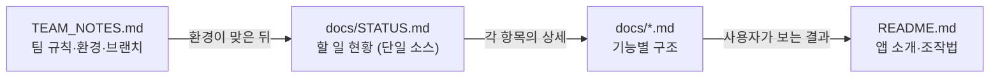

# Keepy 문서

기능별 **현황·구조** 문서 모음. 코드를 열기 전에 "이 기능이 어디서 어떻게 돌아가는지" 먼저 보는 곳.

## 문서 목록

| 문서 | 다루는 것 | 상태 |
|---|---|---|
| [STATUS.md](STATUS.md) | **할 일 전체 현황** — 여기부터 보기 | — |
| [architecture.md](architecture.md) | 레이어 구조, 데이터 흐름, 의존 방향 | 🟢 |
| [screens.md](screens.md) | 3단 화면 셸, 메인·날짜·설정 화면 | 🟢 |
| [tasks.md](tasks.md) | Task 모델, 분류(지연/늦은 완료), 필터·정렬 | 🟢 |
| [gestures.md](gestures.md) | 스와이프·제스처·모션 토큰 | 🟢 |
| [storage.md](storage.md) | 로컬 영속성 (shared_preferences) | 🟢 |
| [auth.md](auth.md) | 로그인·계정 | 🔴 |
| [firebase.md](firebase.md) | Firebase Auth·Firestore 동기화 | 🟡 |
| [ocr.md](ocr.md) | 카메라 + ML Kit 텍스트 인식 | 🟡 |
| [integrations.md](integrations.md) | 알림, eclass, 에브리타임 | 🔴 |

상태: 🟢 구현 완료 · 🟡 일부 구현 · 🔴 미착수

## 다른 문서와의 역할 구분



- **TEAM_NOTES.md** — 사람 쪽 규칙 (Flutter 버전, 브랜치, 디자인 원칙, 제출 기준)
- **docs/STATUS.md** — 남은 일의 단일 소스. 체크리스트는 여기서만 관리
- **docs/\<기능\>.md** — 그 기능의 구조와 구현 위치
- **README.md** — 앱이 무엇이고 어떻게 조작하는지

## 작성 규칙

### 1. 할 일은 위, 완료는 아래

모든 문서는 **읽는 사람이 위에서부터 읽다가 "할 일"을 먼저 만나도록** 쓴다.

```
# 제목
> 상태 한 줄

## 할 일          ← 맨 위
## 구조           ← 다이어그램
## 구현 위치      ← 파일 표
## 완료된 것      ← 맨 아래
```

항목이 끝나면 **지우지 말고** `## 완료된 것`으로 내린다. 날짜를 같이 적는다.

```markdown
- [x] 로컬 저장 구현 (2026-11-02)
```

### 2. 다이어그램은 Mermaid로

그림·캡처 대신 ```` ```mermaid ```` 코드블록을 쓴다. GitHub에서 그대로 렌더링되고, 코드가 바뀌면 텍스트만 고치면 된다.

자주 쓰는 종류:

| 상황 | 문법 |
|---|---|
| 레이어·의존 관계 | `flowchart TD` / `LR` |
| 상태 전이 (할 일 → 지연 → 완료) | `stateDiagram-v2` |
| 시간 순 호출 (저장, 동기화, OCR) | `sequenceDiagram` |
| 모델 관계 | `classDiagram` |
| 단계 일정 | `gantt` |

### 3. 구현 위치는 파일 단위로

줄 번호는 금방 어긋난다. `파일 + 심볼명`으로 적는다.

```markdown
| 파일 | 역할 |
|---|---|
| `lib/state/app_state.dart` | `statusOf()` — 지연·늦은 완료 판정 |
```

### 4. 상태 표시는 3가지만

🟢 완료 · 🟡 일부 · 🔴 미착수. 그 외 기호는 쓰지 않는다.

### 5. 추측과 사실을 섞지 않기

아직 안 만든 것은 "할 일"에 두고, 설계안은 **"계획"**이라고 분명히 적는다. 구현된 것처럼 쓰지 않는다.
