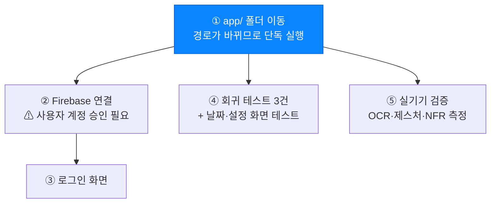
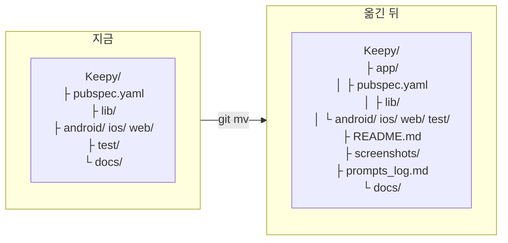

# 작업 현황

> 최종 수정: 2026-11-09 · 기준 브랜치: `희일` · Flutter 3.47.9 stable
> **규칙: 할 일은 위, 끝난 일은 [완료](#완료)로 내린다.** 자세한 구조는 [docs/README.md](README.md) 참고.

## 한눈에

| 영역 | 상태 | 문서 |
|---|---|---|
| 화면·제스처·태스크·로컬 저장 | 🟢 | [screens](screens.md) · [gestures](gestures.md) · [tasks](tasks.md) · [storage](storage.md) |
| 로그인 | 🔴 진입점만 있음 | [auth](auth.md) |
| Firebase 동기화 | 🟡 선행 끝, 연결만 남음 | [firebase](firebase.md) |
| 카메라 OCR | 🟡 코드 완료, 실기기 검증 남음 | [ocr](ocr.md) |
| 알림·외부 서비스 | 🔴 설정 토글만 | [integrations](integrations.md) |

## 🔵 라운드 2 — 다음 배치

라운드 1(2026-11-09)은 전원 완료. 결과는 [완료](#완료) 참고. 다음 배치는 아래 순서로 묶는다.

| 순서 | 담당 | 선행 조건 |
|---|---|---|
| ① `app/` 이동 | 헤드 단독 | 라운드 1 종료 ✅ |
| ② Firebase 연결 + `FirestoreBackend` | sync 담당 | **사용자가 Firebase 프로젝트 생성·`flutterfire configure`** |
| ③ 로그인 화면 | auth 담당 | ② 완료 |
| ④ 회귀 테스트 3건 | test 담당 | ① 완료 |
| ⑤ 실기기 검증 | 사용자 | ① 완료 |

**④ 회귀 테스트 3건** (라운드 1에서 고친 버그가 다시 안 생기게)

- 설정 '달력 행'을 1로 바꿔도 예외 없음
- 체크 후 520ms 안에 삭제 → `doneLog`가 비어 있음
- 액션 패널 열기→닫기 왕복 시 오버플로 없음

**⑤ 실기기에서 잴 것** → `screenshots/README.md`, [ocr.md](ocr.md)

- OCR 실측 시간(NFR-02) · 원본 미저장(NFR-05) · 권한 거부 안내(NFR-07) · 비행기 모드(CST-02)
- 제스처 손맛 — 임계값은 코드상 문서와 일치하지만 데스크톱·웹에서만 확인됨
## 🟠 제출 폴더 구조 — 확정

심사기준이 요구하는 구조다. **지금은 루트가 바로 Flutter 프로젝트**라 이동이 필요하다.

| 항목 | 필수 | 내용 | 상태 |
|---|---|---|---|
| `app/` | ✅ | 앱 소스 전체 | 🔴 이동 필요 |
| `README.md` | ✅ | 화면 구성 · 데이터 구조 · 실행 절차 | 🟡 실행 절차 경로 수정 필요 |
| `screenshots/` | ✅ | 화면별 1장 이상 | 🔴 촬영 필요 |
| `prompts_log.md` | ✅ | 프롬프트 + AI 응답의 **채택/수정 판단** | 🟡 틀만 있음 |

**이동 시 함께 고칠 것** (경로가 바뀌면 깨지는 것들)

- [ ] `git mv` 로 이동 — 이력 보존. 그냥 복사하면 히스토리가 끊긴다
- [ ] `README.md` 실행 절차 — `cd app` 추가
- [ ] `TEAM_NOTES.md` 2장 처음 받기 절차 — `cd Keepy/app`
- [ ] `docs/*.md` 의 모든 코드 경로 — `lib/…` → `app/lib/…`
- [ ] `keepy.iml`, `.idea/` — IDE 설정 경로
- [ ] GitHub Actions 등 CI가 생기면 working-directory

> **라운드 1이 끝나기 전에는 옮기지 않는다.** 서브에이전트 4개가 `lib/`·`test/`·`pubspec.yaml`·`android/` 를 수정 중이라 경로가 바뀌면 전부 깨진다.

---

## 🟠 MP3 — Firebase Auth + Firestore

→ 설계·구조: [firebase.md](firebase.md), [auth.md](auth.md)
→ **선행 작업은 2026-11-09에 끝났다** (아래 완료 참고). 남은 건 실제 Firebase 연결뿐.

- [ ] **Firebase 프로젝트 생성** + Android/iOS 앱 등록, `flutterfire configure` — **사용자 계정 승인 필요**
- [ ] **의존성 추가** — `firebase_core`, `firebase_auth`, `cloud_firestore`
- [ ] **`.env` / `.env.example` 분리** + `.gitignore`에 `.env` 추가 (NFR-06, CST-04)
- [ ] **`FirestoreBackend` 구현** — `SyncBackend` 인터페이스는 이미 있음. `push` `pullTasks` `watchTasks` 채우면 됨
- [ ] **`AppState.reloadFrom(TaskStore)` 추가** — ⚠ **지금 유일한 실질 공백.** 서버에서 병합된 결과를 화면에 반영할 통로가 없어 `SyncStore.onRemoteTasks` 콜백이 비어 있다
- [ ] **`main.dart` 한 줄 교체** — `AppState(store: SyncStore(local: store, backend: FirestoreBackend(...)))`. `AppState.store`가 이미 `TaskStore?`라 다른 수정 불필요
- [ ] **로그인 화면** — 설정의 '게스트' 행이 진입점
- [ ] **tombstone 실제 전환** — 필드·조회 필터(8곳)는 깔려 있음. `remove()`/`clearDone()`을 `deleted = true`로 바꾸고 `restore()`에 `touch()` 추가. ⚠ 되돌리기 UX가 `task_actions.dart`·`task_editor.dart`에 묶여 있어 **위젯 담당과 같이 바꿔야 함**
- [ ] **쓰기 단위 결정** — `SyncStore.write()`가 지금은 전체 목록을 보낸다. 문서당 쓰기로 줄이려면 `TaskStore` 계약 변경 필요. **NFR-03/04 측정 전에 정할 것**
- [ ] **tombstone 정리 기준** — 며칠 뒤 실제 삭제할지 미정
- [ ] **v1 키 정리 시점** — 마이그레이션 후에도 남겨 둠. MP3 마무리 때 제거 판단
- [ ] **측정** — 동기화 3초 이내(NFR-03), 오프라인 복귀 5초 이내(NFR-04) 실측값 README 기록
## 🟡 MP4 — 카메라 + ML Kit

→ 설계·구조: [ocr.md](ocr.md)
→ **코드는 2026-11-09에 붙었다.** 남은 건 실기기 검증과 측정값 기록.

### ⚠ iOS에서는 한국어 인식이 안 된다

`google_mlkit_text_recognition` 1.0.1 기준, iOS는 **라틴 문자만** 지원한다. `TextRecognitionScript.korean`을 넘겨도
죽지는 않고 **라틴 인식기로 조용히 폴백**해서 한글이 안 잡힌다. 추가로 iOS는 배포 타깃 15.0+,
`OTHER_LDFLAGS`에 `-ObjC`·`-all_load`, `LatinOCRResources.bundle` 수동 추가까지 Xcode 작업이 필요하다.

→ **MP4 시연·스크린샷은 Android로 잡는다.** (TEAM_NOTES 8장의 아이폰 확인 절차는 MP1~MP3용)

### 남은 일

- [ ] **Android 실기기 검증** — 한글 인쇄물(강의계획서·시간표)과 손글씨를 각각 촬영, 몇 줄 잡히는지 확인
- [ ] **NFR-02 실측값 README 기록** — 검토 화면이 `N줄 · 0.00초`로 표시하니 그 값을 그대로 적으면 된다
- [ ] **NFR-05 실물 확인** — 촬영 후 `adb shell run-as <패키지> ls cache/` 로 사진이 안 남는지. `image_picker`가 캐시에 복사본을 만들어서 이 확인이 의미 있다
- [ ] **NFR-07 실측** — 카메라 권한을 끈 뒤 촬영 → 안내 팝업 확인. 기기마다 `image_picker`가 주는 code가 달라서, 기본 분기(`인식 실패`)로 떨어지면 `recognize_io.dart`의 `_deniedMessage`에 그 code를 추가해야 한다
- [ ] **비행기 모드 확인** — 모델이 APK에 번들된 것은 확인됨. 스크린샷 한 장이면 CST-02 근거가 된다
- [x] ~~데스크톱 빌드 확인~~ — `flutter build windows --debug` 성공 (2026-11-09, 47.2s). 조건부 import가 데스크톱에서 정상 컴파일됨. 실행 중 샘플 폴백 화면 확인은 남음
- [ ] **측정 구간 합의** — 지금은 사진을 받은 뒤부터 줄 추출까지만 잰다(카메라 앱 체류 시간 제외). NFR-02를 다르게 읽어야 하면 `recognize_io.dart`의 Stopwatch 시작 위치만 올리면 된다
## 🟢 제출 준비

> 폴더 구조는 [확정됨](#-제출-폴더-구조--확정). 이동은 라운드 1 종료 직후.

- [ ] **`app/` 이동 실행** — `git mv` + 경로 참조 전부 수정 ([체크리스트](#-제출-폴더-구조--확정))
- [ ] **`prompts_log.md` 내용 채우기** — 틀은 만들어 둠. 각자 쓴 프롬프트·판단을 취합할 것
- [ ] **`screenshots/` 촬영** — 찍을 목록은 `screenshots/README.md` 에 단계별로 정리됨
- [ ] **README 보강** — 심사기준이 요구하는 3가지: 화면 구성 · **더미(샘플) 데이터 구조** · 실행 절차
- [ ] **MP2 저장 방식 비교** — shared_preferences vs sqflite vs Hive, 고른 이유 ([storage.md](storage.md#할-일))
- [ ] **테스트용 커밋 정리** — `희일` 브랜치의 `만든 폴더/`, `flutter_01.png`(0바이트)
- [ ] 요구사항 명세서 문구 수정 — "왼쪽으로 스와이프 시 설정"이 손가락 방향과 반대 ([screens.md](screens.md#스와이프-방향))

## ⚪ 품질

라운드 1의 오류 담당이 찾았지만 **범위가 달라 안 고친 것들.** 전부 증상이 없거나 발생 확률이 낮아 당장 급하지는 않다.

| 심각도 | 증상 | 위치 |
|---|---|---|
| 중간 | **OCR 일괄 추가에 1~100자 검증이 없다** — 입력 바는 100자 제한인데 OCR 경로만 뚫려 있어 긴 줄이 그대로 들어온다 (CST-03 불일치) | `AppState.addAll` · `ocr_pages.dart` |
| 낮음 | `Toast`의 정적 `Timer`가 위젯 트리보다 오래 산다 — 토스트 뜨는 흐름의 테스트는 1.2초를 `pump` 해야 함 | `lib/widgets/toast.dart` |
| 낮음 | `DatePage.build`가 빌드 중에 상태 필드를 바꾼다 (`_titleDay`, `_dir`) — 지금은 예외 없음 | `lib/pages/date_page.dart` |
| 낮음 | `WeekCalendar.build`가 `PageController`를 빌드 안에서 만들고 매 빌드마다 `addPostFrameCallback`을 건다 | `lib/widgets/week_calendar.dart` |
| 낮음 | '완료 항목 지우기' 되돌리기가 목록 전체 스냅샷을 덮어쓴다 — 지운 뒤 0.6초 안에 새 할 일을 추가하고 취소하면 그 항목이 사라짐 | `AppState.clearDone` / `restoreAll` |
| 낮음 | 작은 화면(720x1280)에서 '달력 행' 4로 두면 날짜 칸이 찌그러진다 (예외는 없음) | `DatePage` CST-01 고정 높이 |

### 그 외

- [ ] **실기기 확인** — 아이폰·안드로이드 모두 아직 아무도 안 함 (TEAM_NOTES 8장)
- [ ] **첫 실행 샘플 7개** — 제출 스크린샷 전에 지울지 결정 (`AppState._seed()`)
- [ ] 테스트 공백 — 날짜 화면 제스처, 설정 화면 UI, OCR 흐름, `EdgeFade` 탭 전환, 다크 모드
- [ ] 다크 모드 — 미검토 (`buildTheme()`은 라이트 전용)
- [ ] `Toast.dismiss()` 테스트 정리 훅을 `lib`에 열지 결정 — 테스트 담당과 조율 필요

---

## 완료

<b>라운드 1 — 서브에이전트 4개 병렬</b> (2026-11-09) · analyze 0건 / test 79개 전부 통과

**테스트 (test-lead)**
- [x] 단위 테스트 65개 신규 — `app_state_test.dart` 46 · `task_model_test.dart` 12 · `local_store_test.dart` 7
- [x] `statusOf()` 4분류 **경계값**, `sortByDate()` 3단 규칙, 되돌리기 왕복, `doneLog` 100개 상한, `neighborTaskDay()`
- [x] 시계 의존 제거(`statusOf(t, now:)` 주입) · 1분 타이머 `addTearDown(dispose)` 정리
- [x] **문서가 사실과 달랐던 것 발견** — TEAM_NOTES의 "test 6개 전부 통과"는 실제로 14개 중 5개 실패 상태였음

**오류 (bug-hunter)**
- [x] **액션 패널 RenderFlex 오버플로 수정** — 고정 폭 `SizedBox(width: 6)`을 버튼별 `Padding(3)`으로. 폭이 0이어도 수학적으로 오버플로 불가. 깨지던 테스트 5개 복구
- [x] **설정 '달력 행' 1로 바꾸면 죽던 크래시 수정** — 칸 2개 미만이면 `CupertinoSlidingSegmentedControl` 대신 고정 라벨
- [x] **체크 후 520ms 안에 삭제하면 '완료 기록'에 남던 버그 수정**
- [x] `Motion.spring` 전수 조사 15곳 → `settings_page._Toggle` 1곳 교정. 나머지는 안전 확인
- [x] 제스처 임계값 10개가 문서와 전부 일치함을 대조 확인
- [x] Chrome 실행으로 3화면·필터·스와이프·편집 시트 콘솔 오류 0 확인

**동기화 선행 (sync-prep)**
- [x] `Task.updatedAt`(LWW) · `deleted`(tombstone) + `touch()`. 구버전 JSON 하위호환
- [x] 저장 키 v2 + v1→v2 마이그레이션 (v1 보존 — 브랜치 비교 중 되돌아갈 때를 위해)
- [x] `TaskStore` 계약 추출 → `AppState.store` 타입 변경. **`main.dart` 한 줄로 Firestore 교체 가능**
- [x] `SyncStore` + `SyncBackend` + 순수 함수 `mergeTasks()` LWW 병합 (Firebase 의존 없음)
- [x] tombstone 조회 필터 8곳 선반영 (`tasks` `todo` `done` `ofStatus` `onDay` `dayCounts` `neighborTaskDay` `tagsByUsage`)

**OCR (ocr-prep)**
- [x] `recognizeLines()`를 실제 ML Kit 경로로 교체 — `image_picker` → `InputImage` → `TextRecognizer(korean)`
- [x] **조건부 export로 웹 분리** — 웹 번들에 ML Kit 코드가 안 들어감. `flutter build web` 성공 확인
- [x] 데스크톱은 `Platform` 가드로 샘플 폴백 (`MissingPluginException` 방지)
- [x] 한국어 모델 `com.google.mlkit:text-recognition-korean:16.0.1` 추가 — **APK 안에 모델 파일 존재까지 확인**
- [x] NFR-05 원본 즉시 삭제(`finally`) · NFR-02 3초 타임아웃 · NFR-07 권한 거부 안내
- [x] 소요 시간 실측 표시 (`N줄 · 0.00초`) · '샘플' 배지는 폴백일 때만
- [x] Android `CAMERA` 권한 + `uses-feature required=false`
- [x] **iOS는 한국어 미지원 발견** — 라틴으로 조용히 폴백. MP4 시연은 Android로 확정

**헤드**
- [x] iOS `Info.plist` 카메라·사진 권한 추가 (2026-11-09)
- [x] 9월부터 남아 있던 `enable-windows-desktop: false` 복원 → `flutter doctor` **No issues found!**
- [x] `flutter build windows --debug` 성공 (47.2s) — 조건부 import 데스크톱 컴파일 검증
- [x] `Motion.spring` 경고 문구 정정 — "예외가 난다" → "그림자 blur가 음수가 되어 깨진다" (3.47.9 재확인)
- [x] `prompts_log.md` 틀 · `screenshots/README.md` 촬영 목록 · `docs/` 11개 문서

<b>MP2 — 수정·삭제·필터·로컬 저장</b> (2026-11-03)

- [x] 로컬 영속성 — `shared_preferences` + JSON, 0.25초 디바운스 자동 저장 (2026-11-02) · [storage.md](storage.md)
- [x] 앱 일시정지 시 즉시 저장 (`HomeShell.didChangeAppLifecycleState`) (2026-11-03)
- [x] 편집 시트 — 제목·태그·날짜 휠 피커·삭제 (2026-11-03)
- [x] 삭제 제스처 — 오른쪽으로 끌기, 스냅 후 버튼 / 230px 이상 즉시 삭제 (2026-11-03)
- [x] 필터 — 전체 / 미완료 / 완료 슬라이딩 세그먼트 (2026-11-02)
- [x] 분류 — 지연 · 할 일 · 늦은 완료 · 완료, 각 날짜순 (2026-11-03) · [tasks.md](tasks.md)
- [x] 완료 이벤트 내역 + 완료 항목 일괄 삭제·되돌리기 (2026-11-03)
- [x] `flutter analyze` 0건, `flutter test` 6개 통과 (2026-11-03)

<b>MP1 — 목록·추가·완료·빈 상태</b> (2026-11-02)

- [x] 3단 수평 스와이프 셸 + 유리 탭 바 (2026-11-02) · [screens.md](screens.md)
- [x] 태스크 추가 — 유리 입력 바, 태그 칩, 1~100자 검증, 빈 입력 흔들림 (2026-11-02)
- [x] 완료 토글 — 네모 체크 + 입자 효과 + 취소선, 0.52초 뒤 이동, 토스트 되돌리기 (2026-11-02)
- [x] 빈 상태 화면 (2026-11-02)
- [x] 주 스와이프 캘린더 — 완료율 색, 할 일 있는 날로만 이동 (2026-11-03)
- [x] 왼쪽 끌기 스냅 다이얼 — [날짜] +1~+7 / [태그] 빈도순 (2026-11-03) · [gestures.md](gestures.md)
- [x] 설정 화면 — 달력 행·이번 주 위치·완료율 표시 방식 (2026-11-03)
- [x] Pretendard 폰트 + 디자인 토큰 `theme.dart` (2026-11-02)

