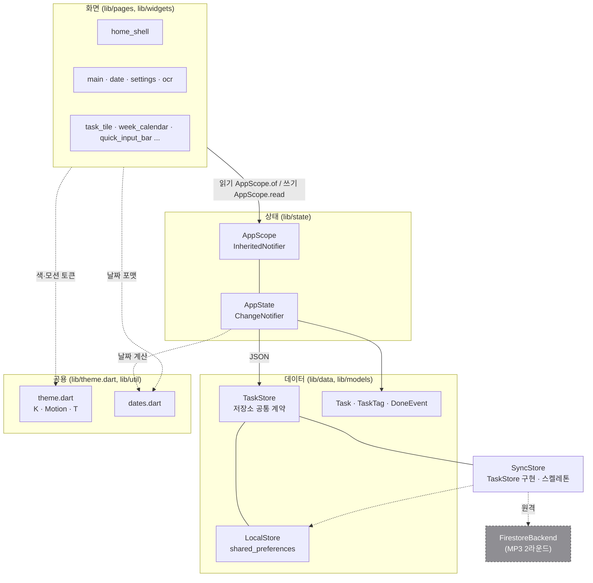
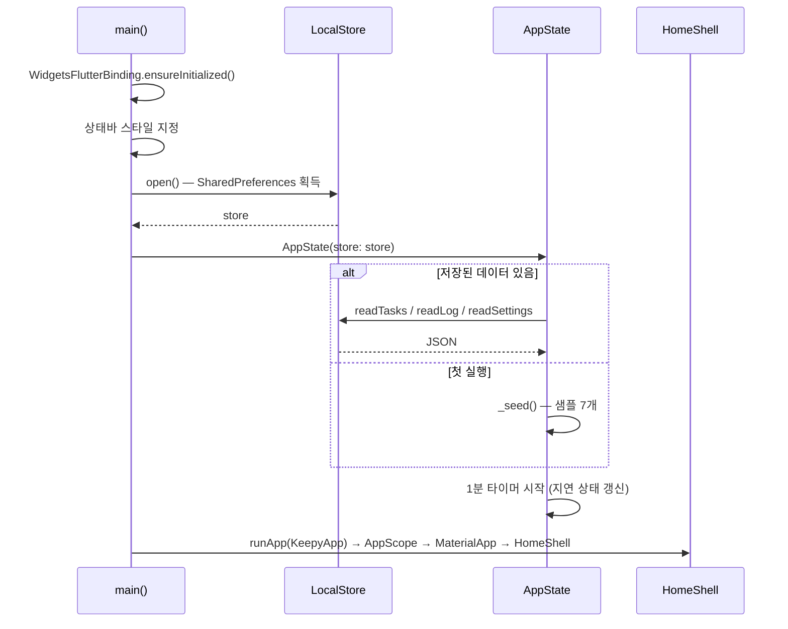
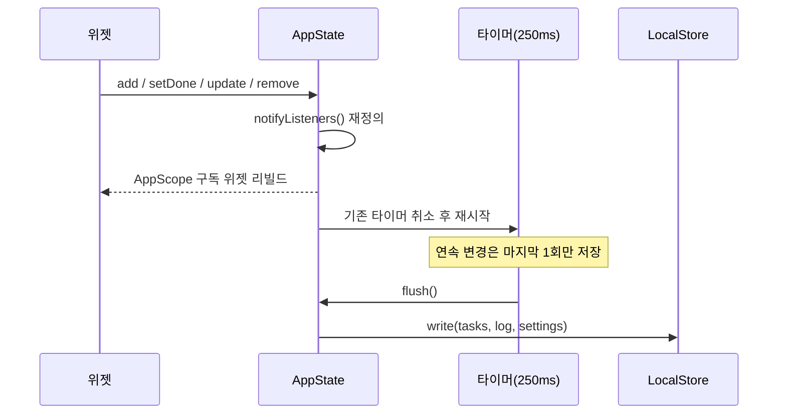

# 전체 구조

> 🟢 구현 완료 · 패턴: `ChangeNotifier` + `InheritedNotifier` (외부 상태관리 패키지 없음)

## 할 일

- [ ] `AppState`에 **저장된 JSON에서 목록을 다시 읽는 수단**이 없다 — 서버에서 병합된 결과를
    화면에 반영하려면 필요하다 (`SyncStore.onRemoteTasks`에 연결할 자리, [firebase.md](firebase.md))

## 레이어

**의존 방향은 한쪽으로만** — 화면 → 상태 → 데이터. 데이터 계층은 화면을 모른다.

## 앱 시작

## 상태 전파와 저장

`notifyListeners()`를 **오버라이드해서 저장을 걸어 둔 것**이 이 구조의 핵심. 화면 코드는 저장을 신경 쓰지 않는다.

## 구현 위치

| 파일 | 역할 |
|---|---|
| `lib/main.dart` | 진입점, 저장소 open, `MaterialApp`, iOS식 스크롤(`_AppleScroll`) |
| `lib/state/app_state.dart` | `AppState` — 태스크·설정·화면 상태 전부. `AppScope` 주입 |
| `lib/data/task_store.dart` | `TaskStore` — `AppState`가 보는 저장소 계약 |
| `lib/data/local_store.dart` | `LocalStore` — JSON 읽기/쓰기 + v1 → v2 마이그레이션 |
| `lib/data/sync_store.dart` | `SyncStore` · `SyncBackend` — 동기화 계층 스켈레톤 (MP3) |
| `lib/models/task.dart` | `Task` · `TaskTag` · `DoneEvent` + JSON 변환 |
| `lib/theme.dart` | 색(`K`)·모션(`Motion`)·타이포(`T`) 토큰. **화면 파일에 색 직접 쓰지 않기** |
| `lib/util/dates.dart` | 날짜 계산·한국어 포맷 |

## 규칙

- 화면에서 상태를 **읽을 때** `AppScope.of(context)` (리빌드 구독), **콜백 안에서 쓸 때** `AppScope.read(context)`
- 색·애니메이션 시간은 `theme.dart`에서만 가져온다
- `Motion.spring`은 1을 넘어 튀는 곡선 → **그림자·투명도 보간에 쓰면 예외 발생**. 그런 곳은 `Motion.out`

## 완료된 것

- [x] 저장소를 `TaskStore` 인터페이스로 분리 — `AppState`를 고치지 않고 동기화 계층 교체 가능 (2026-11-09)
- [x] 레이어 분리와 단방향 의존 (2026-11-02)
- [x] 디바운스 자동 저장 + 앱 일시정지 시 즉시 저장 (2026-11-03)
- [x] 1분 주기 리빌드로 '지연' 상태 자동 반영 (2026-11-03)
