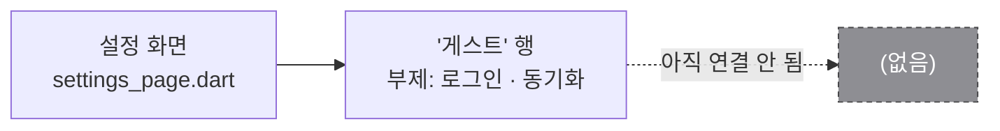
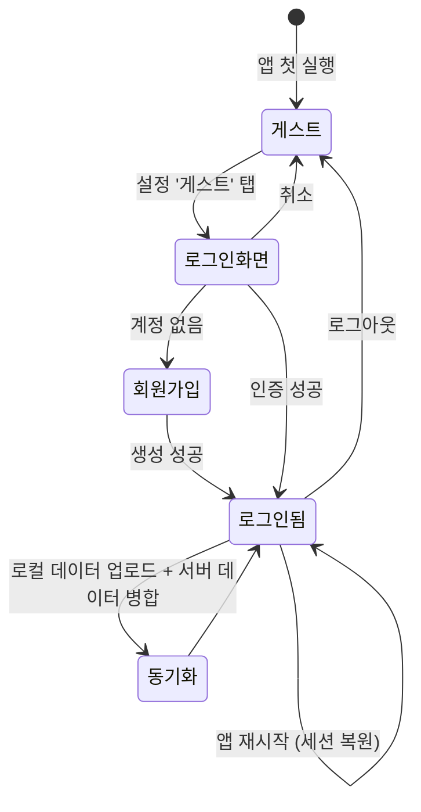
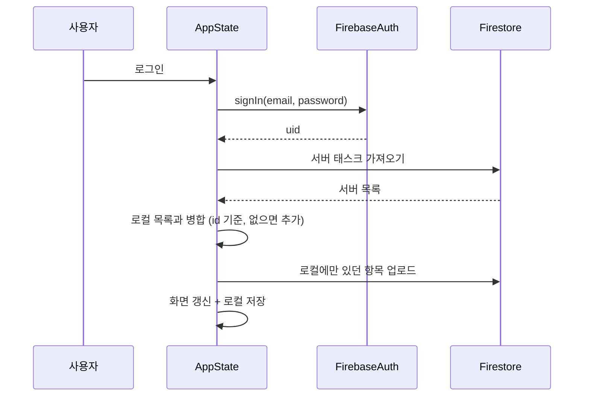

# 로그인 · 계정

> 🔴 **미착수** — 설정 화면에 진입점만 있음 · 요구사항 FR-01 · 단계 MP3
> 아래 "구조"는 전부 **계획**이다. 아직 구현된 코드가 없다.

## 할 일

- [ ] 로그인 방식 결정 — **이메일+비밀번호** / Google / 익명(게스트)
    → 권장: 익명 + 이메일 연결. 게스트로 쓰다가 로그인하면 기존 로컬 데이터를 그대로 올림
- [ ] `firebase_auth` 추가 ([firebase.md](firebase.md))
- [ ] `lib/pages/login_page.dart` 신규 — 설정의 '게스트' 행에서 진입
- [ ] `AppState`에 현재 사용자 보관 + 로그아웃 시 로컬 데이터 처리 정책 결정
- [ ] 로그인 상태에 따라 설정 행 표시 바꾸기 (게스트 → 이메일 + 로그아웃)
- [ ] 사용자별 저장 공간 분리 — 로컬 키에 uid를 붙일지 결정 (`keepy.tasks.v1.<uid>`)

## 현재 있는 것

`lib/pages/settings_page.dart` 첫 섹션의 `_Row(title: '게스트', subtitle: '로그인 · 동기화')`.
탭해도 아무 일도 일어나지 않는다. **여기가 MP3 로그인의 진입점**이다.

## 계획 — 화면 흐름

## 계획 — 게스트 데이터 승계

가장 조심할 부분. 게스트로 쌓은 할 일이 로그인하면서 사라지면 안 된다.

> 병합 규칙과 충돌 해결은 [firebase.md](firebase.md#계획--동기화-규칙)에서 같이 정한다.

## 보안 (NFR-06, CST-04)

- API 키는 `.env`로 분리하고 저장소에는 `.env.example`만 둔다
- `.gitignore`에 `.env` 추가 (현재 `.gitignore`에 아직 없음 → MP3 시작 시 추가)
- `firebase_options.dart` 커밋 여부는 팀에서 결정 (클라이언트 키라 공개가 치명적이진 않지만, 과제 규격상 분리 권장)
- 비밀번호는 절대 로컬에 저장하지 않는다 — 세션은 `firebase_auth`가 관리

## 참고: 이전 프로토타입

9월 프로토타입(`todo_app`)에는 인터페이스 분리형 가짜 BaaS 로그인이 있었다.
지금 저장소와 코드 구조가 다르므로 **그대로 옮기지 말고**, `BaasClient` 같은 **인터페이스로 추상화하는 방식만** 참고할 것.

## 완료된 것

- [x] 설정 화면에 '게스트' 진입점 자리 확보 (2026-11-03)
