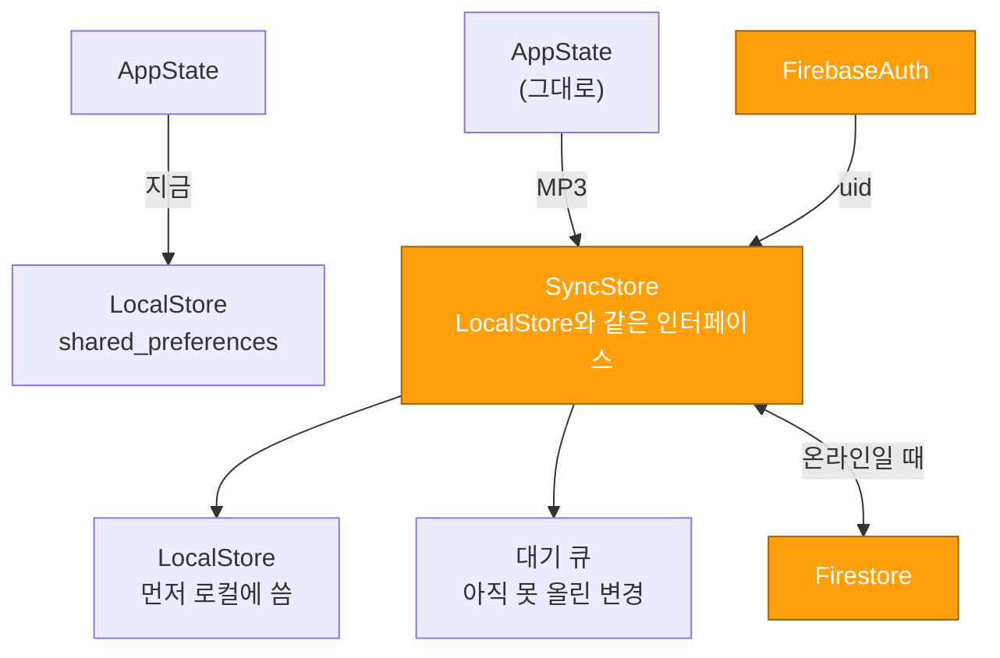
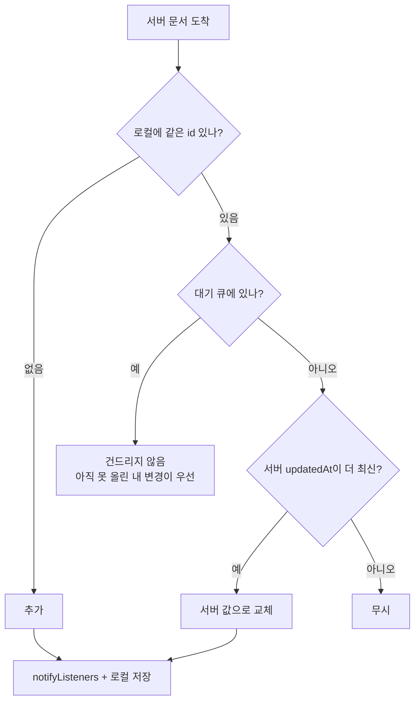
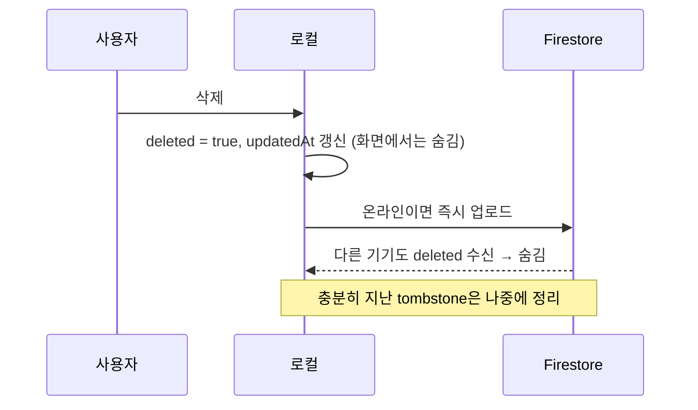
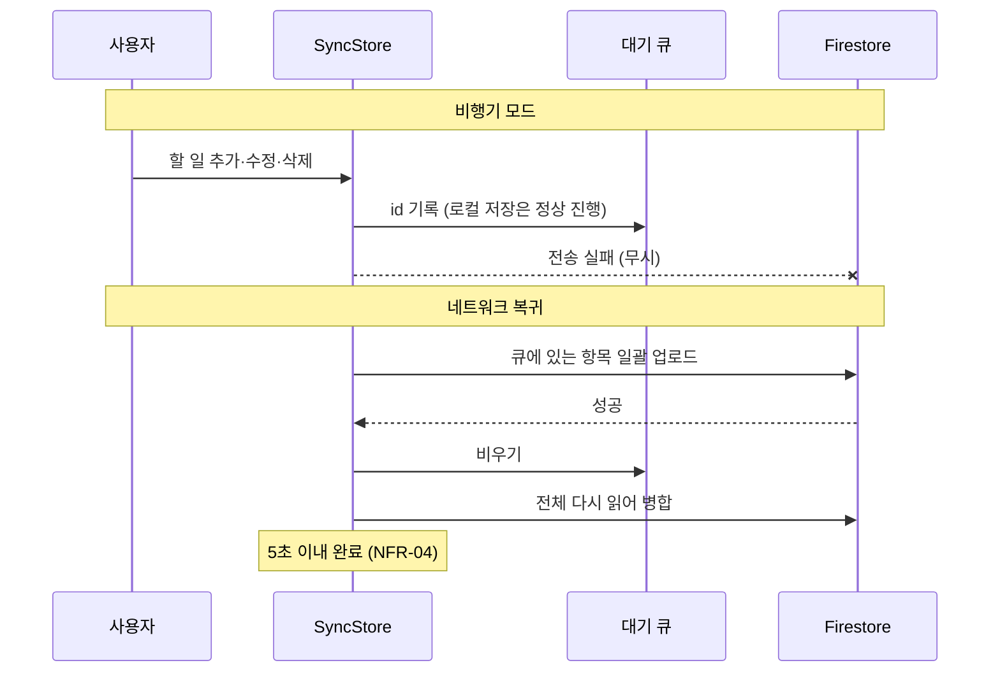

# Firebase 동기화

> 🟡 **선행 조건만 완료** — Firebase 의존성은 아직 없음 (계정 승인 대기) · 요구사항 FR-11, FR-12, NFR-03, NFR-04 · 단계 MP3
> 모델·저장 키·인터페이스 스켈레톤까지 끝났다. **원격과 실제로 주고받는 코드는 아직 없다.**
> 아래 "계획"은 여전히 설계안이다.

## 할 일

### 1. 준비
- [ ] Firebase 콘솔에서 프로젝트 생성, Android·iOS 앱 등록
- [ ] `dart pub global activate flutterfire_cli` → `flutterfire configure`
- [ ] 의존성 추가
    ```yaml
    firebase_core: ^3.x
    firebase_auth: ^5.x
    cloud_firestore: ^5.x
    ```
    → 버전은 Flutter 3.47.9 / Dart 3.13.7에 맞는 것으로 확인 후 고정
- [ ] `main()`에 `Firebase.initializeApp()` 추가 (`LocalStore.open()` 앞)
- [ ] Android `minSdk` 확인 — Firestore는 21 이상
- [ ] `.env` / `.env.example` 분리 + `.gitignore`에 `.env` 추가 (NFR-06, CST-04)

### 2. 구현
- [ ] `SyncBackend` 구현체 `FirestoreBackend` — `push` `pullTasks` `watchTasks`
- [ ] Firestore 스키마 확정 (아래 [문서 구조](#계획--firestore-문서-구조))
- [ ] `main()`에서 `LocalStore` 대신 `SyncStore`를 `AppState`에 넘기기 (타입은 이미 `TaskStore?`)
- [ ] 실시간 수신 — `watchTasks()` 구독 → `SyncStore.mergeTasks()` → `AppState` 다시 읽기
    `AppState`에 **저장된 JSON에서 목록을 다시 읽는 메서드가 없다** → `SyncStore.onRemoteTasks`에 연결할 것
- [ ] 온라인 여부 판정 (`SyncBackend.canSync`) — 연결 감시 방법 결정
- [ ] `remove()`를 tombstone으로 전환 ([tasks.md](tasks.md#할-일))
- [ ] 오래된 tombstone 정리

### 3. 검증
- [ ] 두 기기(또는 에뮬레이터 2대)에서 같은 계정 로그인 → 양쪽 반영 확인 (FR-11)
- [ ] 비행기 모드에서 작성 → 복귀 후 전송 확인 (FR-12)
- [ ] **실측값 README 기록** — 동기화 3초 이내(NFR-03), 오프라인 복귀 5초 이내(NFR-04)

## 끼우는 자리 (2026-11-09 완료)

`AppState`는 더 이상 `LocalStore`를 직접 들고 있지 않다. 공통 인터페이스
`TaskStore`(`lib/data/task_store.dart`)만 보기 때문에 **`AppState`를 고치지 않고**
`LocalStore` 자리에 `SyncStore`를 넣을 수 있다.

```dart
// main.dart — 2라운드에서 이 한 줄만 바뀐다
final store = await LocalStore.open();
runApp(KeepyApp(state: AppState(store: store)));
// → AppState(store: SyncStore(local: store, backend: FirestoreBackend(...)))
```

| 심볼 | 상태 | 하는 일 |
|---|---|---|
| `TaskStore` | 🟢 | `AppState`가 보는 저장소 계약 (`LocalStore`가 구현) |
| `SyncStore` | 🟢 | 로컬 우선 쓰기 · 대기 큐 · `mergeTasks()` LWW 병합 |
| `SyncBackend` | 🟢 인터페이스 | 원격 추상화 (`uid` `canSync` `push` `pullTasks` `watchTasks`) |
| `NoopSyncBackend` | 🟢 | 기본값. 끼워도 지금과 동작이 같다 |
| `FirestoreBackend` | 🔴 | **2라운드** |

읽기는 전부 로컬이고(`readTasks` → `local.readTasks()`), `write()`는 로컬을 먼저 끝낸 뒤
태스크 id를 대기 큐에 넣고 `canSync`일 때만 `push`한다. 실패하면 큐에 남는다.

## 계획 — 어디에 끼우나

**`AppState`를 고치지 않는 것**이 목표였다.



**로컬 우선(local-first)** — 항상 로컬에 먼저 쓰고 화면을 갱신한 뒤, 네트워크는 뒤에서 처리한다. 그래야 오프라인에서도 느려지지 않는다.

## 계획 — Firestore 문서 구조

```
users/{uid}/tasks/{taskId}
users/{uid}/doneLog/{eventId}
users/{uid}/settings/app
```

태스크 문서는 **지금 로컬 JSON 형식을 그대로 쓴다** (TEAM_NOTES 5장).

```json
{
  "id": "m3x9k2p0",
  "title": "운영체제 과제",
  "done": false,
  "due": "2026-11-03T00:00:00.000",
  "tags": ["assignment", "team"],
  "createdAt": "2026-11-02T21:40:12.000",
  "doneAt": null,
  "updatedAt": "2026-11-03T10:12:00.000",
  "deleted": false
}
```

`updatedAt`·`deleted`가 **동기화를 위해 새로 필요한 두 필드**다 → 모델에 추가 완료 (2026-11-09).
로컬 저장 키도 `keepy.*.v2`로 올렸다 ([storage.md](storage.md#키-버전-마이그레이션-v1--v2)).

보안 규칙은 본인 문서만 읽고 쓰게 한다.

```
match /users/{uid}/{document=**} {
  allow read, write: if request.auth != null && request.auth.uid == uid;
}
```

## 계획 — 동기화 규칙

### 충돌 해결: Last-Write-Wins



이 흐름도는 `SyncStore.mergeTasks({local, remote, pending})`로 구현했다.
**순수 함수**라 Firebase 없이도 단위 테스트할 수 있다. `updatedAt`이 없거나 깨진 문서는
`createdAt`으로, 그것도 없으면 아주 과거로 보고 비교한다 (구버전 문서가 섞여도 안전).

### 삭제

오프라인에서 지운 항목을 다른 기기에 전파하려면 **바로 지우지 않고 표식**을 남긴다.

> 모델의 `deleted` 필드와 조회 쪽 필터(`AppState._live`)는 준비됐지만,
> `AppState.remove()`는 **아직 실제로 목록에서 뺀다**. 되돌리기 UX가
> `remove()`의 반환 인덱스 + `restore(index, task)`에 묶여 있어서, Firestore를
> 붙이는 2라운드에 함께 전환한다 ([tasks.md](tasks.md#할-일)).



### 오프라인 → 복귀 (FR-12, NFR-04)



> Firestore에는 자체 오프라인 캐시(`persistence`)가 있다. 그걸 그대로 쓸지, 위처럼 직접 큐를 둘지는 **구현 시작 전에 정할 것**. 직접 큐를 두면 동작을 설명하기 쉽고 측정도 쉽다.

## 측정 방법 (제출용)

| 항목 | 기준 | 재는 법 |
|---|---|---|
| NFR-03 동기화 반영 | 3초 이내 | 기기 A에서 추가 → 기기 B 화면에 뜰 때까지 `Stopwatch` |
| NFR-04 오프라인 복귀 | 5초 이내 | 비행기 모드 해제 → 큐가 비워질 때까지 |

측정값은 README에 적는다.

## 참고: 이전 프로토타입

9월 `todo_app`에는 `BaasClient` 인터페이스 + 가짜 구현으로 FR-11/12를 시연한 코드가 있었다.
**인터페이스로 추상화하면 화면 코드를 안 고쳐도 된다**는 점만 참고하고, 코드는 구조가 달라 그대로 옮기지 않는다.

## 완료된 것

선행 조건(Firebase 없이 끝낼 수 있는 것)만 끝났다.

- [x] `Task`에 `updatedAt` · `deleted` 추가, 구버전 JSON 하위호환 (2026-11-09)
- [x] 저장 키 `v2` + v1 → v2 마이그레이션 (2026-11-09)
- [x] `TaskStore` 인터페이스 분리 — `AppState`가 저장소 종류를 모르게 (2026-11-09)
- [x] `lib/data/sync_store.dart` — `SyncBackend` 인터페이스 + `NoopSyncBackend` + `SyncStore`
      (로컬 우선 쓰기 · 대기 큐 · LWW 병합) (2026-11-09)
