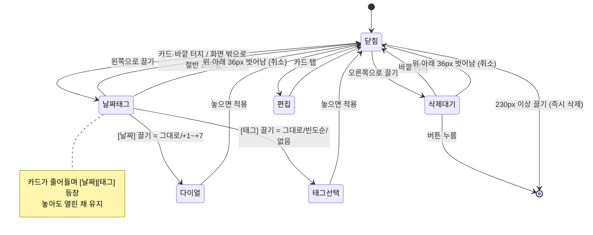
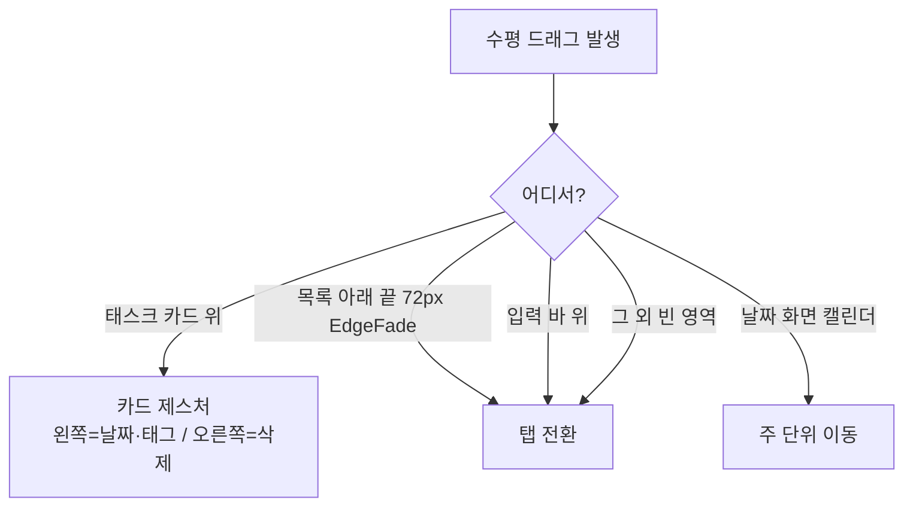

# 제스처 · 모션

> 🟢 구현 완료 · 요구사항 FR-07, FR-09, NFR-01 · Apple HIG 참고

## 할 일

- [ ] 실기기에서 제스처 감 확인 — 현재 데스크톱·웹에서만 확인됨
- [ ] NFR-01(0.3초 이내 반응) 실측값 기록 — 현재는 토큰 설계값만 있음

## 임계값 한눈에

모두 `lib/widgets/task_tile.dart`의 상수다.

| 상수 | 값 | 뜻 |
|---|---|---|
| `_actW` | 150px | 왼쪽 끌기 — [날짜][태그] 영역 폭 |
| `_delW` | 76px | 오른쪽 끌기 — 삭제 버튼 폭 |
| `_follow` | 0.72 | 버튼 폭까지 손가락을 따라가는 비율 (그 뒤는 고무줄 저항) |
| `_fullDelete` | 230px | 이만큼 끌면 버튼 없이 바로 삭제 |
| `_cancelDy` | 36px | 위·아래로 이만큼 벗어나면 동작 취소 |
| `_commitDelay` | 520ms | 체크 후 실제 완료 처리까지 (애니메이션을 보여 주려는 지연) |
| `_maxStep` | 7 | 날짜 다이얼 최대 +7일 |

## 태스크 카드 제스처

### 손가락을 그대로 따라가지 않는 이유

버튼 폭까지는 **72%만** 따라오고, 그 뒤부터 고무줄 저항이 걸린다. iOS 알림 센터의 스와이프 액션과 같은 감각을 내려는 것.

## 화면 전환과 충돌 회피

- 목록 **아래 끝 72px**(입력 바 바로 위)에 들어온 항목은 작아지며 흐려지고 **터치를 받지 않는다**(`EdgeFade`) → 그 영역에서 좌우로 밀면 탭 전환
- 입력 바는 **누를 때만** 입력 시작. 그 위에서 좌우로 밀면 탭 전환
- 날짜 화면의 날짜 이동에 좌우 제스처를 **쓰지 않는 이유**도 이 충돌 때문 ([screens.md](screens.md#날짜-이동))

## 모션 토큰

`lib/theme.dart`

| 토큰 | 값 | 쓰는 곳 |
|---|---|---|
| `Motion.fast` | 160ms | 작은 전환 |
| `Motion.med` | 280ms | 기본 |
| `Motion.slow` | 420ms | 화면·시트 |
| `Motion.out` | `easeOutCubic` | 일반 보간 |
| `Motion.spring` | `Cubic(0.2, 0.9, 0.25, 1.12)` | 위치·크기 |

> ⚠ `Motion.spring`은 **1을 넘어 튀는 곡선**이다. 그림자(`boxShadow`)·투명도 보간에 쓰면 값이 범위를 벗어나
> **그림자가 한 프레임 사라지는 식으로 깨진다** — `BoxShadow.scale`이 음수 blur를 막지 않기 때문. 그런 곳은 `Motion.out`.
>
> 과거 이 조합으로 테스트가 깨진 적이 있다. Flutter 3.47.9에서는 `Color.lerp`가 알파를 clamp해 예외까지
> 가지는 않지만(2026-11-09 재확인), 그림자가 깨지는 문제는 그대로라 규칙은 유지한다.

## 구현 위치

| 파일 | 역할 |
|---|---|
| `lib/widgets/task_tile.dart` | 카드 제스처 전체, 스냅 다이얼, 삭제 |
| `lib/widgets/task_actions.dart` | [날짜][태그] 액션 패널 |
| `lib/widgets/square_check.dart` | 네모 체크 + 입자 효과, 취소선 |
| `lib/widgets/fx.dart` | 눌림·유리·링·롤링 숫자 등 공통 효과 |
| `lib/widgets/toast.dart` | 0.6초 토스트, 다른 곳 누르면 즉시 닫힘 |
| `lib/widgets/glass_tab_bar.dart` | 스와이프 추종 알약 |
| `lib/main.dart` | `_AppleScroll` — 전 플랫폼 바운스 + 마우스 드래그 허용 |

## 완료된 것

- [x] 왼쪽 끌기 — [날짜][태그] 패널, 고무줄 저항, 유지 (2026-11-03)
- [x] 날짜 스냅 다이얼 +1~+7 / 태그 빈도순 다이얼 (2026-11-03)
- [x] 오른쪽 끌기 — 삭제 스냅 + 230px 즉시 삭제 (2026-11-03)
- [x] 위·아래 36px 이탈 시 취소 (2026-11-03)
- [x] 네모 체크 입자 효과 + 520ms 지연 커밋 (2026-11-02)
- [x] `EdgeFade` 영역·입력 바 위에서 탭 전환 (2026-11-03)
- [x] 0.6초 토스트 (2026-11-02)
