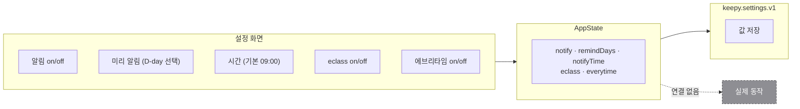
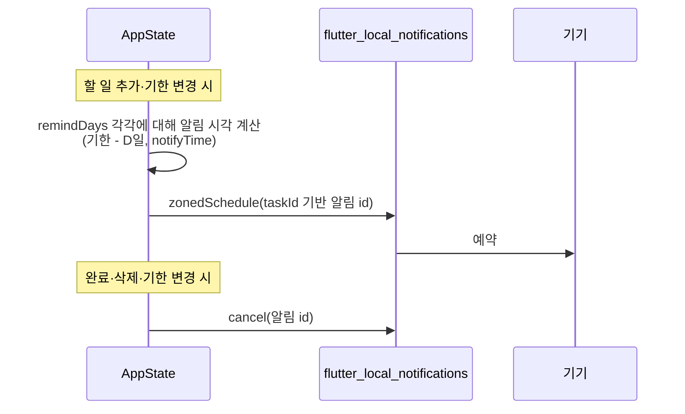

# 알림 · 외부 서비스 연동

> 🔴 **설정 토글만 있고 동작 없음** — 값은 저장되지만 아무 기능도 수행하지 않는다
> 요구사항 명세서에 없는 **자체 확장 항목**이다. 구현 여부를 팀에서 먼저 정할 것.

## 할 일

- [ ] **구현할지 결정** — MP3·MP4가 끝나기 전에는 손대지 않는 것을 권장
- [ ] 알림: `flutter_local_notifications` + 권한(Android 13+ `POST_NOTIFICATIONS`, iOS 승인)
- [ ] eclass / 에브리타임: **연동 방식이 미정** — 공개 API가 없다. 아래 [주의](#주의) 참고
- [ ] 토글이 아무것도 안 한다는 점을 UI에 표시하거나, 구현 전까지 숨기기

## 현재 상태

| 설정 | `AppState` 필드 | 저장 | 동작 |
|---|---|---|---|
| 알림 | `notify` | 🟢 | 🔴 |
| 미리 알림 | `remindDays: Set<int>` (기본 `{0}`) | 🟢 | 🔴 |
| 시간 | `notifyTime` (기본 09:00) | 🟢 | 🔴 |
| eclass | `eclass` | 🟢 | 🔴 |
| 에브리타임 | `everytime` | 🟢 | 🔴 |

## 계획 — 알림

- 알림 id는 `task.id` 해시로 만들어 **취소·갱신이 가능**해야 한다
- 과거 시각은 예약하지 않는다
- 권한 거부 시 설정 토글을 꺼진 상태로 되돌리고 안내

## 주의

**eclass·에브리타임은 공개 API가 없다.** 가능한 선택지는:

| 방식 | 문제 |
|---|---|
| 웹 스크래핑 | 학교 계정 비밀번호를 앱이 받아야 함 → **보안·과제 규정상 부적절** |
| 사용자가 직접 내보낸 파일(ics 등) 가져오기 | 현실적. 다만 범위가 커짐 |
| 토글만 두고 "준비 중" 표시 | 지금 상태 |

→ **비밀번호를 받는 방식은 쓰지 않는다.** 구현한다면 파일 가져오기 쪽으로.

## 구현 위치

| 파일 | 역할 |
|---|---|
| `lib/pages/settings_page.dart` | 알림·eclass·에브리타임 토글 UI |
| `lib/state/app_state.dart` | `setNotify` `toggleRemind` `setNotifyTime` `setEclass` `setEverytime` |
| `lib/state/app_state.dart` · `_settingsJson()` | 설정 저장 |

## 완료된 것

- [x] 설정 UI + 값 영속화 (2026-11-03)
