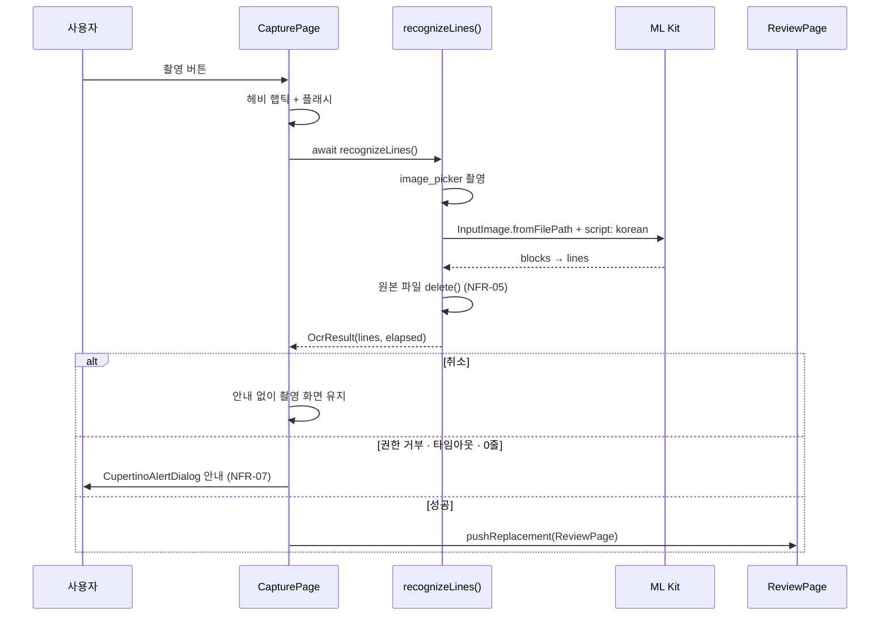
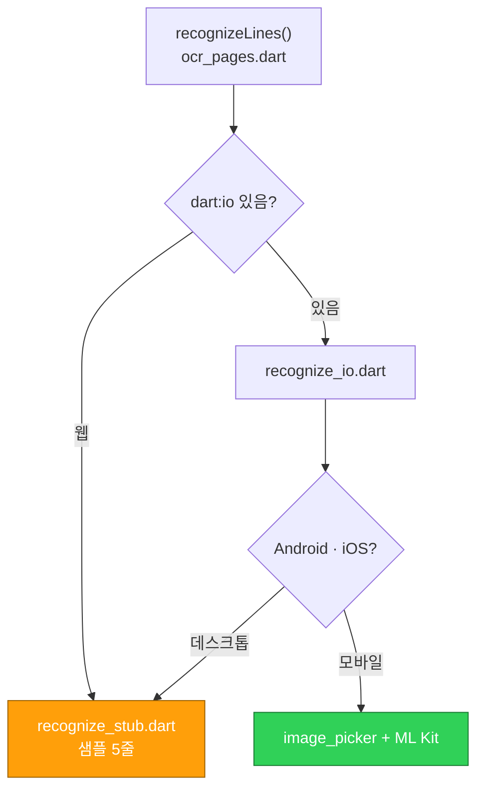

# 카메라 · OCR

> 🟡 **Android 실제 인식까지 구현, iOS·실기기 미검증** · 요구사항 FR-13, FR-14, NFR-02, NFR-05, NFR-07, CST-02 · 단계 MP4

## 할 일

- [ ] **iOS 권한** — `ios/Runner/Info.plist`에 `NSCameraUsageDescription`,
      `NSPhotoLibraryUsageDescription` (한국어 문구). Windows에서는 확인 불가 → Mac 담당자
- [ ] **⚠ iOS는 한국어 인식이 안 된다** — `google_mlkit_text_recognition` 1.0.1은 iOS에서
      라틴 문자만 링크한다. `TextRecognitionScript.korean`을 넘기면 **죽지는 않고** 라틴
      인식기로 조용히 폴백한다 → 한글이 안 잡힘. 플러그인 README가 "not supported yet"이라고 명시.
      iOS에서 쓰려면 추가로 필요한 것:
      | 할 것 | 어디 |
      |---|---|
      | 배포 타깃 15.0 이상 | Xcode Runner |
      | `OTHER_LDFLAGS`에 `-ObjC`, `-all_load` | Runner > Build Settings > Linking |
      | `LatinOCRResources.bundle` 추가 | Runner > Build Phases > Copy Bundle Resources |
      → **MP4 시연은 Android로 할 것.** iOS는 라틴만 되거나 아예 빈 결과가 나온다
- [ ] **실기기 인식 검증** — 에뮬레이터·실기기 확인은 아직 안 함. 컴파일만 통과 확인
    - 한글 손글씨·인쇄물 각각 몇 줄 잡히는지
    - 권한 거부 시 안내 팝업이 실제로 뜨는지 (NFR-07)
    - 촬영 후 캐시에 사진이 남지 않는지 (NFR-05) — `files()`로 앱 캐시 확인
- [ ] 비행기 모드에서 동작 확인 (온디바이스라 네트워크 불필요, CST-02)
- [ ] **실측값 README 기록** (NFR-02) — 검토 화면 상단에 `N줄 · 0.00초`로 소요 시간이 표시된다.
      실기기 값을 그대로 적을 것
- [ ] 데스크톱 빌드 확인 — 이 작업 시점의 PC에 Visual Studio 툴체인이 없어 `flutter build windows` 미확인.
      Dart 쪽은 `Platform.isAndroid/isIOS` 가드로 샘플 폴백으로 빠지게 해 둠

## 현재 흐름



플랫폼별로 구현이 갈린다:



## 웹·데스크톱을 깨뜨리지 않는 방법

ML Kit과 `image_picker`의 파일 처리는 `dart:io`에 기댄다. `ocr_pages.dart`에서 바로
import하면 **`flutter build web`이 컴파일 단계에서 깨진다.** 팀 전원이 `-d chrome`·`-d windows`로
개발하므로(TEAM_NOTES 2장·8장) 조건부 export로 갈라 뒀다.

```dart
// lib/pages/ocr/recognize.dart
export 'recognize_stub.dart' if (dart.library.io) 'recognize_io.dart';
```

- **웹**: `dart.library.io`가 false → `recognize_stub.dart`만 컴파일된다.
  ML Kit 코드는 웹 번들에 들어가지도 않음
- **데스크톱**: `dart:io`는 있지만 ML Kit 플러그인이 없다. `recognize_io.dart` 첫 줄에서
  `Platform.isAndroid || Platform.isIOS`로 막고 샘플 폴백으로 보낸다
  (안 막으면 `MissingPluginException`)
- 폴백일 때만 검토 화면에 **'샘플' 배지**가 붙는다 (`OcrResult.sample`)

⚠ 앞으로 `ocr_pages.dart`에 ML Kit·`dart:io`를 직접 import하지 말 것. 넣을 코드는
`recognize_io.dart`로.

## 구현 위치

| 파일 | 역할 | 상태 |
|---|---|---|
| `lib/pages/ocr_pages.dart` · `recognizeLines()` | 진입점 — 구현체로 위임 | 🟢 |
| `lib/pages/ocr/recognize.dart` | 조건부 export (웹 / `dart:io`) | 🟢 |
| `lib/pages/ocr/recognize_io.dart` · `recognizeLinesImpl()` | 촬영 + ML Kit 한국어 인식, 원본 삭제 | 🟢 |
| `lib/pages/ocr/recognize_stub.dart` | 웹 폴백 | 🟢 |
| `lib/pages/ocr/ocr_result.dart` · `OcrResult` | 결과·안내 문구·타임아웃 상수 | 🟢 |
| `lib/pages/ocr_pages.dart` · `_CapturePageState._notice()` | 권한 거부·타임아웃 안내 팝업 | 🟢 |
| `lib/pages/ocr_pages.dart` · `CapturePage` | 촬영 UI, 스캔 애니메이션, 플래시, 햅틱 | 🟢 |
| `lib/pages/ocr_pages.dart` · `ReviewPage` | 검토·선택·일괄 추가, 줄 수·소요 시간 표시 | 🟢 |
| `android/app/build.gradle.kts` | 한국어 모델 `implementation` | 🟢 |
| `android/app/src/main/AndroidManifest.xml` | `CAMERA` 권한 | 🟢 |
| `ios/Runner/Info.plist` | 카메라·사진 권한 문구 | 🔴 |
| `lib/widgets/quick_input_bar.dart` | 카메라 진입 버튼 | 🟢 |
| `lib/state/app_state.dart` · `addAll()` | 선택 항목 일괄 등록 | 🟢 |

## 지켜야 할 제약

| ID | 내용 | 지금 상태 |
|---|---|---|
| CST-02 | 외부 유료 API 금지, 온디바이스 ML Kit만 | 🟢 네트워크 호출 없음, 모델은 APK에 번들 |
| NFR-05 | 원본 이미지 기기·서버에 저장 금지 | 🟢 인식 직후 `finally`에서 `delete()` · 실기기 확인 남음 |
| NFR-02 | 촬영 → 검토 화면 3초 이내 | 🟡 `ocrTimeout` 3초 + 실측 표시 구현 · 실측값 기록 남음 |
| NFR-07 | 권한 거부 시 안내 | 🟢 `_notice()` 팝업 — 권한·타임아웃·0줄 각각 문구 다름 |

### 소요 시간을 어디서 재는가

촬영 시간(사용자가 카메라 앱에 머무는 시간)은 재지 않는다. `image_picker`가 사진을
돌려준 뒤부터 줄 추출까지만 `Stopwatch`로 재고, 같은 구간에 3초 `timeout`을 건다.
NFR-02의 "3초"는 인식 성능 기준이라고 해석했다 — 다르게 봐야 하면 이 부분만 고치면 된다.

## 완료된 것

- [x] 촬영 화면 — 스캔선 애니메이션, 플래시, 햅틱 (2026-11-03)
- [x] 검토 화면 — 줄 단위 체크·수정, N개 일괄 추가 (2026-11-03)
- [x] `recognizeLines()` 한 함수만 바꾸면 되도록 분리 (2026-11-03)
- [x] 의존성 추가 — `image_picker` 1.2.4 + `google_mlkit_text_recognition` 1.0.1 (2026-11-09)
- [x] `recognizeLines()` 실제 구현 — 촬영 → `InputImage.fromFilePath` → 줄 단위 추출 (2026-11-09)
- [x] **Android 한국어 모델 의존성 직접 추가** (2026-11-09)
    ```kotlin
    // android/app/build.gradle.kts
    dependencies {
        implementation("com.google.mlkit:text-recognition-korean:16.0.1")
    }
    ```
    플러그인이 한국어 모델을 `compileOnly`로만 선언한다. 빼면 `TextRecognitionScript.korean`
    호출 시 `NoClassDefFoundError`로 앱이 죽는다. (9월 프로토타입에서 실제로 겪은 문제)
    버전 `16.0.1`은 플러그인 1.0.1의 `android/build.gradle`과 맞춘 값
- [x] Android 권한 — `AndroidManifest.xml`에 `android.permission.CAMERA` (2026-11-09)
- [x] **원본 이미지 즉시 삭제** (NFR-05) — `finally`에서 캐시 파일 `delete()` (2026-11-09)
- [x] **권한 거부 안내** (NFR-07) — `camera_access_denied`·`photo_access_denied` 분기 팝업 (2026-11-09)
- [x] 3초 타임아웃 (NFR-02) — `ocrTimeout`, 초과 시 안내 팝업 (2026-11-09)
- [x] 데스크톱·웹 폴백 — 조건부 export + `Platform` 가드, 샘플 5줄 유지 (2026-11-09)
- [x] 검토 화면의 '샘플' 배지는 **폴백일 때만** 표시 (2026-11-09)
- [x] 소요 시간 측정 — `OcrResult.elapsed` → 검토 화면 `N줄 · 0.00초` (2026-11-09)
- [x] `flutter build web` 성공 확인, `flutter analyze` OCR 관련 0건 (2026-11-09)
