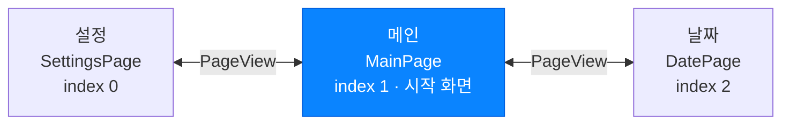
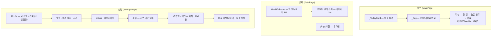
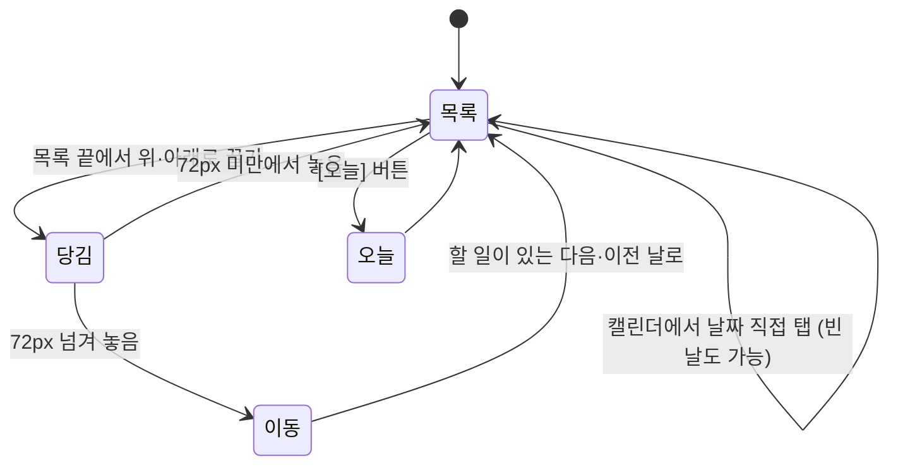

# 화면

> 🟢 구현 완료 · UI설계서 04 기준 · 요구사항 FR-07, FR-08, CST-01

## 할 일

- [ ] **로그인 화면 추가** — 설정의 '게스트' 행이 진입점 ([auth.md](auth.md))
- [ ] 요구사항 명세서 문구 수정 — 아래 [스와이프 방향](#스와이프-방향) 참고
- [ ] 다크 모드 — `buildTheme()`은 현재 라이트 전용

## 3단 구조

`PageView(initialPage: 1)` + 하단 `GlassTabBar`. 탭 알약이 스와이프 진행도를 따라 움직인다.
페이지가 바뀌면 `HapticFeedback.selectionClick()` + 키보드 내림. 키보드가 올라오면 탭 바를 숨긴다.

### 스와이프 방향

요구사항 명세서의 "왼쪽으로 스와이프 시 설정"은 **손가락 방향과 반대**라 혼동이 있다.
구현은 **화면 배치 기준**으로 맞췄다.

| 손가락 | 결과 |
|---|---|
| 오른쪽으로 밀기 → | 왼쪽 화면(설정)이 나옴 |
| 왼쪽으로 밀기 ← | 오른쪽 화면(날짜)이 나옴 |

## 화면별 구성

**CST-01 (상단 1/4 : 하단 3/4)** — `DatePage`에서 `SizedBox(height: mq.size.height / 4)`로 캘린더 높이를 고정한다.

## 날짜 이동

좌우 제스처는 화면 전환과 겹치므로 **쓰지 않는다**. 대신:

날짜 제목은 **제스처 진행도와 동기화되어** 따라 넘어간다.

## 구현 위치

| 파일 | 역할 |
|---|---|
| `lib/pages/home_shell.dart` | `PageView` 3단, 탭 바 연결, 생명주기 저장 |
| `lib/pages/main_page.dart` | 오늘 카드, 세그먼트 필터, 4개 분류 목록 |
| `lib/pages/date_page.dart` | 캘린더 1/4 + 목록 3/4, 상하 당겨 날짜 이동 |
| `lib/pages/settings_page.dart` | 설정 섹션 전체, '게스트' 행 |
| `lib/widgets/glass_tab_bar.dart` | 유리 탭 바, 스와이프 추종 알약 |
| `lib/widgets/week_calendar.dart` | 주 단위 캘린더, 완료율 색 |
| `lib/widgets/diff_sliver_list.dart` | 추가·삭제·이동 애니메이션 목록 |
| `lib/widgets/empty_state.dart` | 빈 상태 |

## 캘린더 칸 색

| 색 | 뜻 |
|---|---|
| 파랑 (진할수록 많음) | 남은 할 일 있음 |
| 초록 (진할수록 많음) | 전부 완료 |
| 그라데이션 숫자 + 밑줄 | 오늘 |
| 그라데이션 채움 | 선택된 날 |

## 완료된 것

- [x] 3단 `PageView` + 유리 탭 바, 알약 스와이프 추종 (2026-11-02)
- [x] 메인 — 오늘 카드·세그먼트 필터·4분류 목록 (2026-11-03)
- [x] 날짜 — 1/4 캘린더 + 3/4 목록, 상하 당겨 이동, [오늘] 버튼 (2026-11-03)
- [x] 설정 — 전 섹션 UI (2026-11-03)
- [x] 키보드 올라올 때 탭 바 숨김 (2026-11-03)
