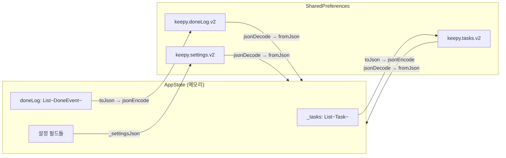
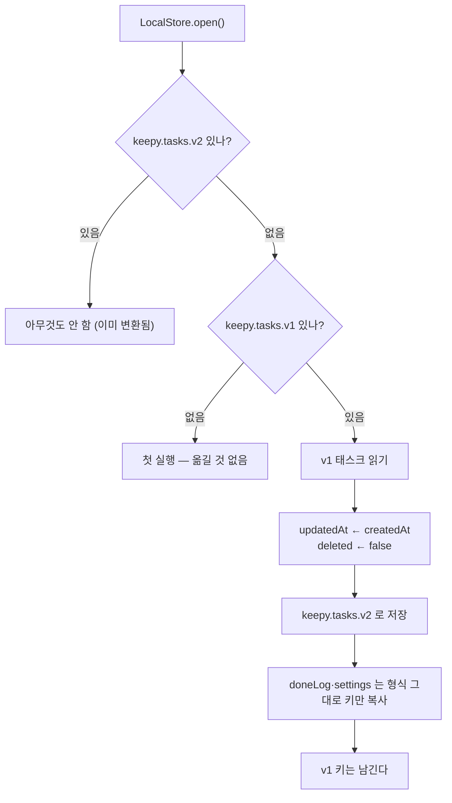
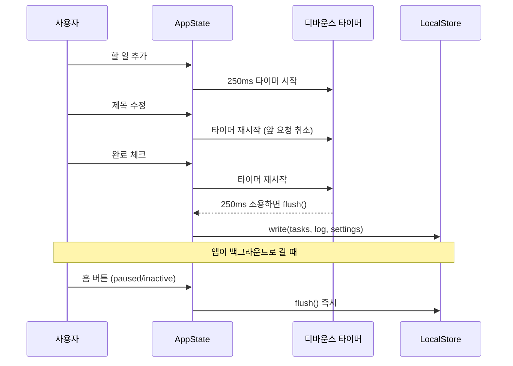
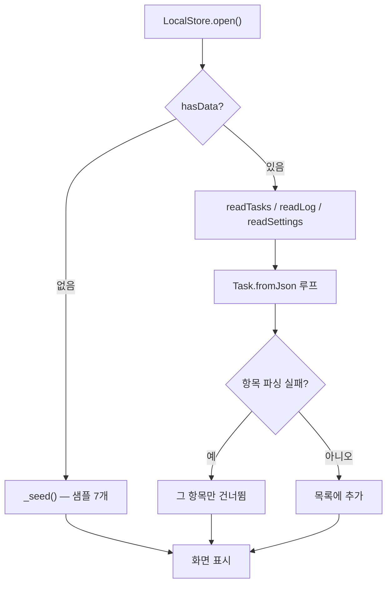

# 로컬 영속성

> 🟢 구현 완료 · 요구사항 FR-10 · `shared_preferences` + JSON

## 할 일

- [ ] **MP2 README에 저장 방식 선택 이유 작성** — 대안 비교 필요 (심사 항목)
    | 후보 | 적합성 |
    |---|---|
    | `shared_preferences` | 수십~수백 건 키-값. 쿼리 불필요 → **채택** |
    | `sqflite` | 조건 검색·대량 데이터에 유리. 지금 규모엔 과함 |
    | `Hive` / `Isar` | 빠르지만 의존성·코드 생성 부담 |
- [ ] 남겨 둔 **v1 키 정리** — v2가 충분히 검증된 뒤(MP3 마무리) 한 번 지운다
- [ ] 재시작 전후 스크린샷 (제출물)

## 저장 구조

| 키 | 담는 것 |
|---|---|
| `keepy.tasks.v2` | 태스크 배열 (`updatedAt` · `deleted` 포함) |
| `keepy.doneLog.v2` | 완료 이벤트 (최대 100개) |
| `keepy.settings.v2` | 달력 행·이번 주 위치·완료율 표시·알림·지연 기준 등 |

> 구조를 바꾸면 키 버전을 올리고 변환 코드를 쓴다.

## 키 버전 마이그레이션 (v1 → v2)

동기화 필드가 생겨서 `v1` → `v2`로 올렸다 (2026-11-09). **기존 사용자의 할 일이 사라지면 안 되므로**
`LocalStore.open()`이 저장소를 열자마자 한 번 변환한다.

- 태스크만 형식이 바뀐다. 완료 내역·설정은 **키만 올린다**.
- 맵 수준에서만 손댄다 (`_upgradeTask`) — `LocalStore`는 모델을 모르는 계층이다.
  `Task.fromJson`도 같은 기본값을 쓰므로(하위호환) 변환이 빠져도 읽기는 깨지지 않는다.
- **v1 키는 지우지 않고 남긴다.** 브랜치별로 구현을 비교·선정하는 동안(TEAM_NOTES 3장)
  v1 코드로 되돌아가 실행하는 일이 흔하고, 변환에 문제가 생겨도 원본으로 다시 시작할 수 있다.
  담는 양이 수십~수백 건이라 중복 보관 비용도 사실상 없다.
  단, 그 사이 v1 빌드에서 고친 내용은 v2로 다시 올라오지 않는다.

## 저장 시점

- 연속 변경은 **마지막 한 번만** 디스크에 쓴다
- `HomeShell.didChangeAppLifecycleState`에서 `paused`·`inactive`일 때 즉시 저장 → 앱이 죽어도 유실 없음

## 복원

앱 시작 시 `LocalStore.hasData`로 판단한다.

JSON이 깨져도 **앱이 죽지 않는다** — 리스트 전체 파싱 실패는 빈 목록, 개별 항목 실패는 그 항목만 건너뛴다.

## 구현 위치

| 파일 | 역할 |
|---|---|
| `lib/data/task_store.dart` | `TaskStore` — `AppState`가 보는 저장소 계약 |
| `lib/data/local_store.dart` | `open()` `hasData` `readTasks` `readLog` `readSettings` `write()` |
| `lib/data/local_store.dart` | `_migrateV1()` `_upgradeTask()` — v1 → v2 변환 |
| `lib/state/app_state.dart` | `notifyListeners()` 오버라이드로 디바운스 저장, `flush()`, `_load()`, `_settingsJson()` |
| `lib/models/task.dart` | `toJson` / `fromJson` |
| `lib/pages/home_shell.dart` | 생명주기 즉시 저장 |

## 테스트

`test/local_store_test.dart` — `SharedPreferences.setMockInitialValues({})` 로 메모리 저장소를 쓴다.

| 확인하는 것 | 방법 |
|---|---|
| 저장 → 재시작 → 복원 왕복 | `flush()` 뒤 `LocalStore.open()`을 다시 열어 새 `AppState` 생성 |
| 250ms 디바운스 | 변경 직후엔 안 쓰였고, 0.4초 뒤에 쓰였는지 |
| 깨진 JSON 방어 | 키에 JSON 아닌 문자열 → 빈 목록 |
| 손상 항목 건너뜀 | 배열에 `id`·`due`가 깨진 항목을 섞어 넣음 |
| 첫 실행 판정 | 태스크 키가 없으면 `_seed()` 7개 (이때 **설정도 읽지 않음**) |

> `AppState(store: ...)`는 1분 주기 타이머를 만들므로 테스트에서 `addTearDown(s.dispose)` 로 정리할 것.

## MP3에서 바뀔 부분

`LocalStore`는 **그대로 두고** 같은 모양의 동기화 계층으로 감싼다 → [firebase.md](firebase.md)

공통 인터페이스 `lib/data/task_store.dart`(`TaskStore`)를 뽑아 뒀다. `AppState.store`의 타입이
`TaskStore?`라서 `LocalStore` 자리에 `SyncStore`를 넣는 것만으로 끼워진다.

## 완료된 것

- [x] 저장 키 v2 + v1 → v2 마이그레이션 (2026-11-09)
- [x] `TaskStore` 인터페이스 분리 — `LocalStore`/`SyncStore` 교체 가능 (2026-11-09)
- [x] `shared_preferences` JSON 저장·복원 (2026-11-02)
- [x] 250ms 디바운스 자동 저장 (2026-11-02)
- [x] 생명주기 즉시 저장 (2026-11-03)
- [x] 손상 데이터 방어 (2026-11-02)
- [x] 설정값까지 영속화 (2026-11-03)
