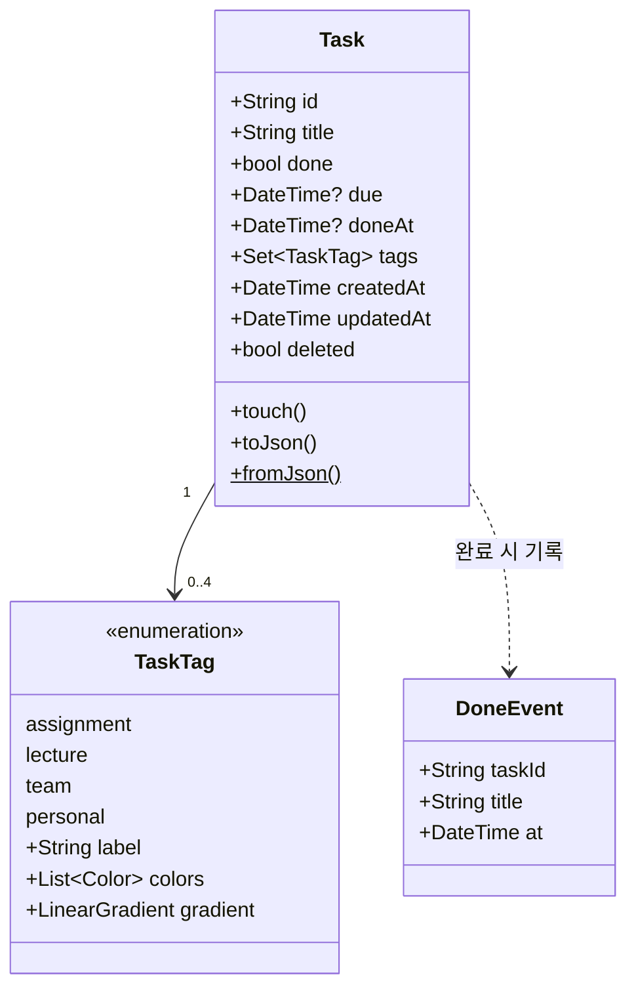
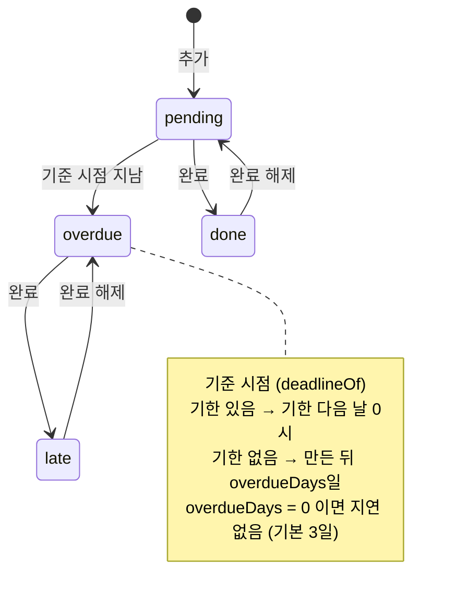
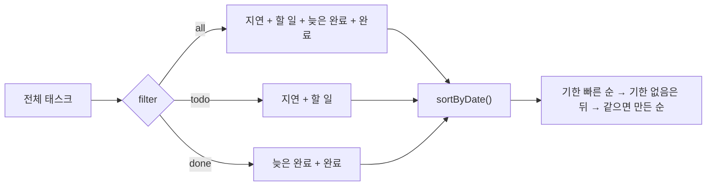

# 태스크 도메인

> 🟢 구현 완료 · 요구사항 FR-02 ~ FR-06, CST-03

## 할 일

- [ ] **`remove()`를 tombstone 방식으로 전환** — Firestore를 붙일 때 (지금은 목록에서 실제로 뺀다)
    조회 쪽은 이미 `AppState._live`에서 `deleted`를 걸러 두었으므로 바꿀 곳은
    `remove()` · `clearDone()` 두 군데와 **`restore(index, task)`의 인덱스 의미**다
    (tombstone이 `_tasks`에 남으면 `_live` 기준 인덱스와 어긋난다)
- [ ] 오래된 tombstone 정리 기준 정하기 (며칠 지나면 실제 삭제할지)
- [ ] 제목 길이 상한을 모델에서도 검증 — 현재는 입력 바 UI에서만 1~100자 제한 (CST-03)
- [ ] 샘플 데이터(`_seed()` 7개) 유지 여부 결정

## 모델

| 태그 | 라벨 | 그라데이션 |
|---|---|---|
| `assignment` | 과제 | 파랑 → 보라 |
| `lecture` | 수업 | 보라 → 핑크 |
| `team` | 팀 프로젝트 | 주황 → 핑크 |
| `personal` | 개인 | 초록 → 청록 |

`id`는 `microsecondsSinceEpoch`를 36진수로 바꾼 값 + 순번 (`AppState._nextId`).

### 동기화용 필드 (2026-11-09 추가)

| 필드 | 쓰임 | 기본값 |
|---|---|---|
| `updatedAt` | Last-Write-Wins 비교 기준. `touch()`로 갱신 | `createdAt` |
| `deleted` | tombstone — 오프라인 삭제를 다른 기기에 전파 | `false` |

- 갱신 지점: `setDone` · `update` (제목·태그·기한). 새 항목은 생성자가 `createdAt`과 같게 맞춘다.
- **하위호환** — 구버전 JSON에 두 필드가 없으면 `Task.fromJson`이 위 기본값으로 채운다.
- 조회(`tasks` `todo` `done` `ofStatus` `onDay` `dayCounts` `neighborTaskDay` `tagsByUsage`)는
  전부 `AppState._live`를 거쳐 `deleted == true`를 걸러낸다. 저장·동기화는 tombstone까지 쓴다.

## 상태 분류

할 일은 **지연 · 할 일 · 늦은 완료 · 완료** 네 가지로 나뉜다. 메인 화면은 이 순서로 묶어 보여 준다.

판정은 `AppState.statusOf(Task)`. 완료 시점 `doneAt`을 기준 시점과 비교해 **늦은 완료**를 가른다.
시간이 흘러 지연으로 넘어가는 것을 반영하려고 `AppState`가 **1분마다** 리빌드를 건다.

## 정렬과 필터

## 구현 위치

| 파일 | 역할 |
|---|---|
| `lib/models/task.dart` | `Task` · `TaskTag` · `DoneEvent`, JSON 변환, `touch()` |
| `lib/state/app_state.dart` | `_live` — tombstone 걸러낸 목록 (**모든 조회의 입구**) |
| `lib/state/app_state.dart` | `statusOf()` 분류 · `sortByDate()` · `ofStatus()` · `tagsByUsage()` |
| `lib/state/app_state.dart` | `add` `addAll` `setDone` `update` `remove` `restore` `clearDone` `restoreAll` |
| `lib/pages/main_page.dart` | 4분류 렌더링, 세그먼트 필터 |
| `lib/widgets/task_editor.dart` | 편집 시트 (제목·태그·날짜·삭제) |
| `lib/util/dates.dart` | `dayOf` `addDays` `dayDiff` `dueLabel` |

## 되돌리기

| 동작 | 되돌리는 방법 |
|---|---|
| 완료 토글 | 토스트의 취소 (0.52초 뒤 실제 반영되므로 그 전에도 가능) |
| 삭제 | `remove()`가 인덱스를 반환 → `restore(index, task)` (tombstone으로 바꾸지 않은 이유) |
| 완료 일괄 삭제 | `clearDone()`이 전체 스냅샷 반환 → `restoreAll(snapshot)` |

## 테스트

| 파일 | 다루는 것 |
|---|---|
| `test/app_state_test.dart` | `statusOf()` 4분류 **경계값**, `sortByDate()`, `add`/`addAll`/`update`, 되돌리기, `doneLog` 100개 상한, `tagsByUsage()`, `neighborTaskDay()`, 설정 |
| `test/task_model_test.dart` | `Task`·`DoneEvent` JSON 왕복, 알 수 없는 태그·깨진 필드 처리, `TaskTag` 라벨·색 |

`AppState(store: null, seed: false)` 로 **메모리 전용** 인스턴스를 만들면 위젯 펌프 없이 바로 검증할 수 있다.
분류·정렬은 `statusOf(t, now: ...)` 와 `createdAt`을 직접 넣어 **시계에 의존하지 않게** 쓴다.

## 완료된 것

- [x] 동기화용 필드 `updatedAt` · `deleted` 추가 + 구버전 JSON 하위호환 (2026-11-09)
- [x] 조회 전체를 `_live`로 모아 tombstone 필터 (2026-11-09)
- [x] Task 모델 + JSON 직렬화 (2026-11-02)
- [x] 태그 4종, 그라데이션 색 (2026-11-02)
- [x] 추가·수정·삭제·완료 토글, 되돌리기 (2026-11-03)
- [x] 4분류 판정 `statusOf()` + 1분 주기 갱신 (2026-11-03)
- [x] 필터 3종, 날짜순 정렬 (2026-11-03)
- [x] 완료 이벤트 내역 (최대 100개) (2026-11-03)
- [x] 태그 사용 빈도순 정렬 `tagsByUsage()` (2026-11-03)
