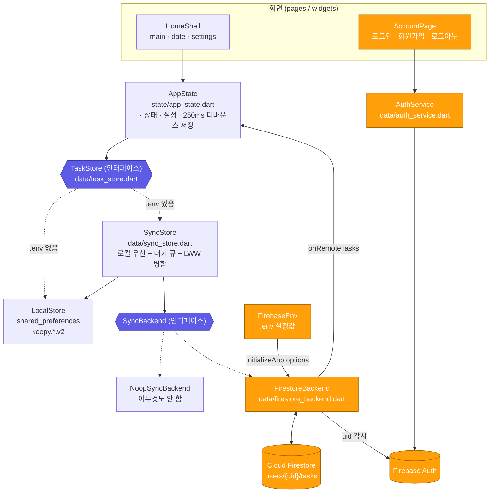
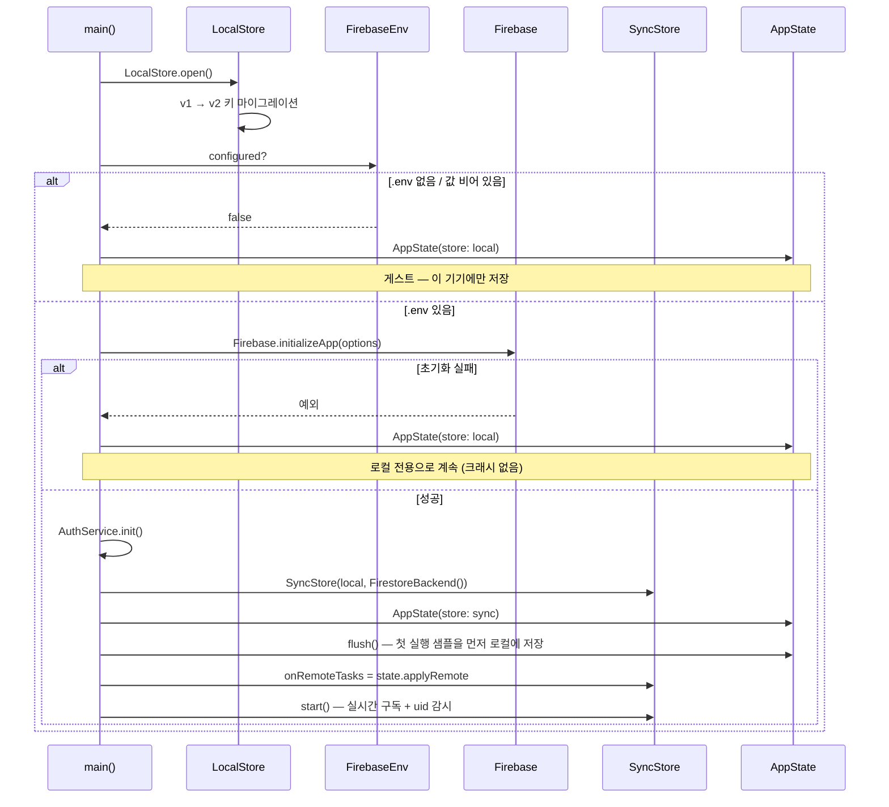
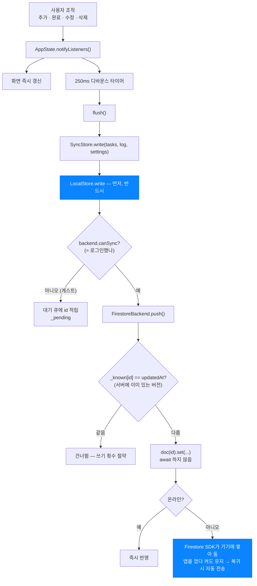
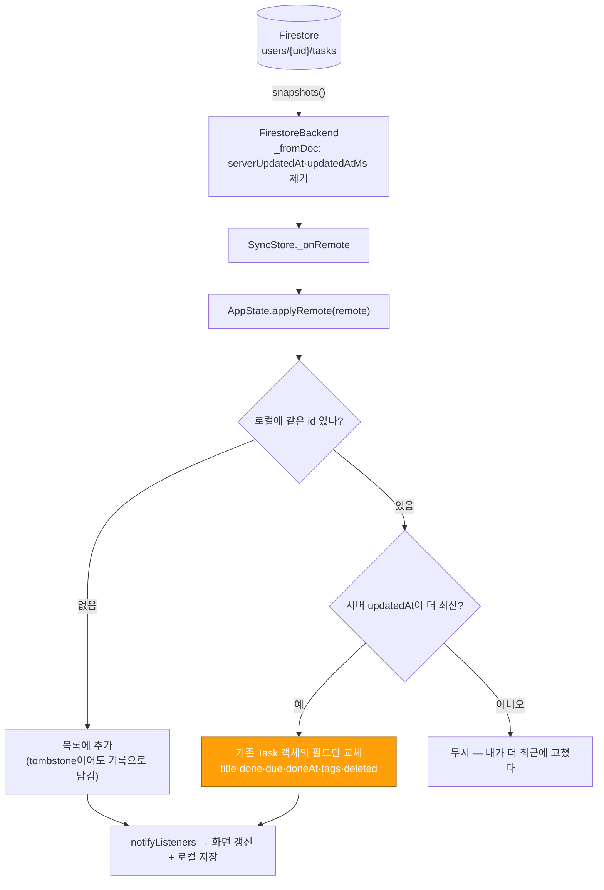
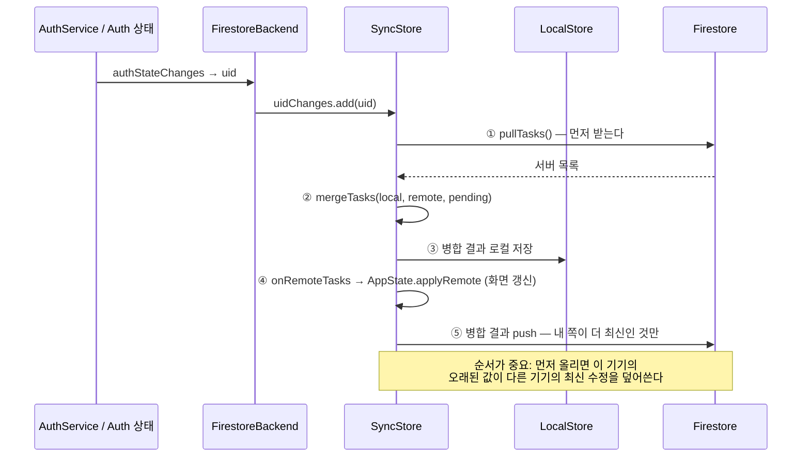
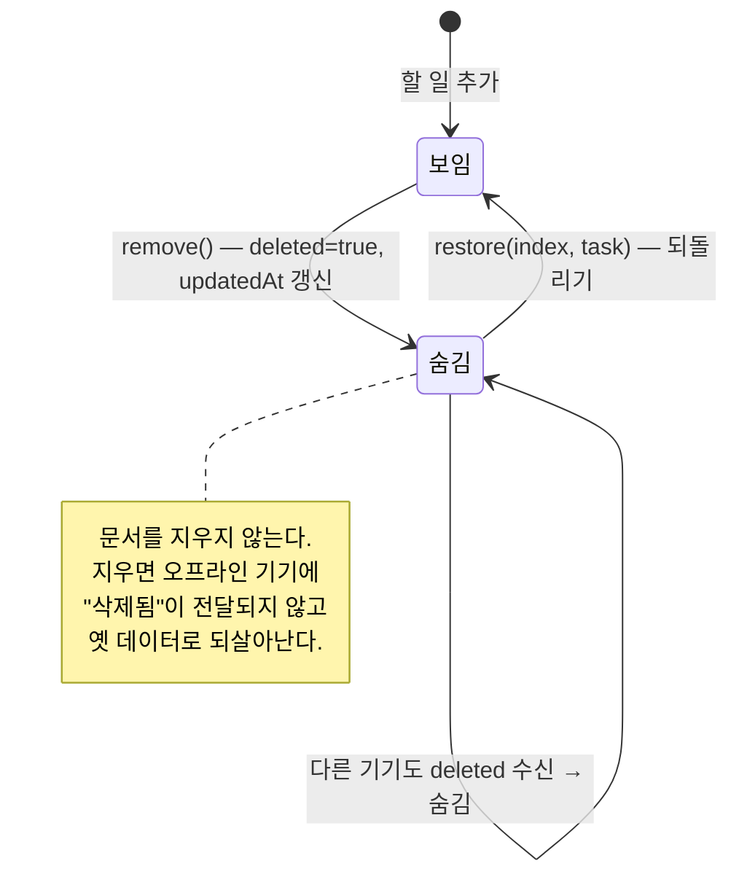
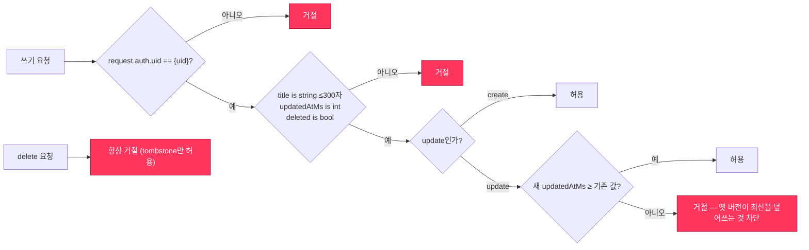
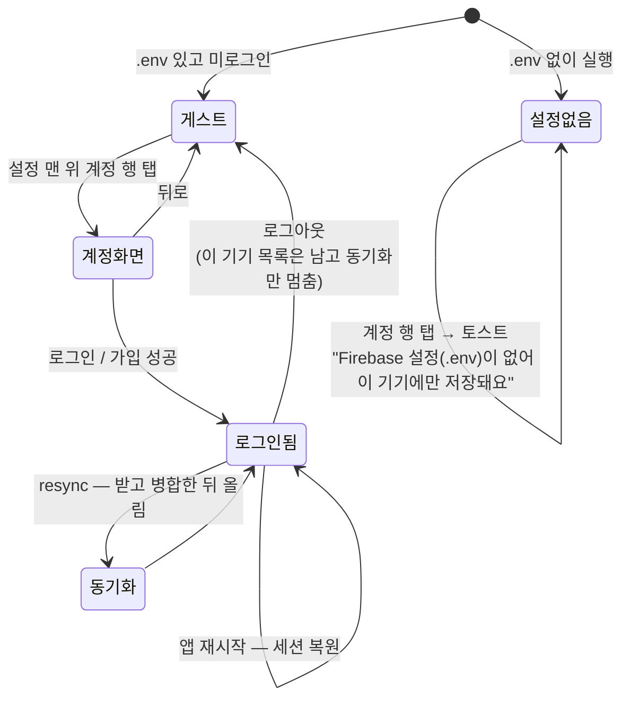
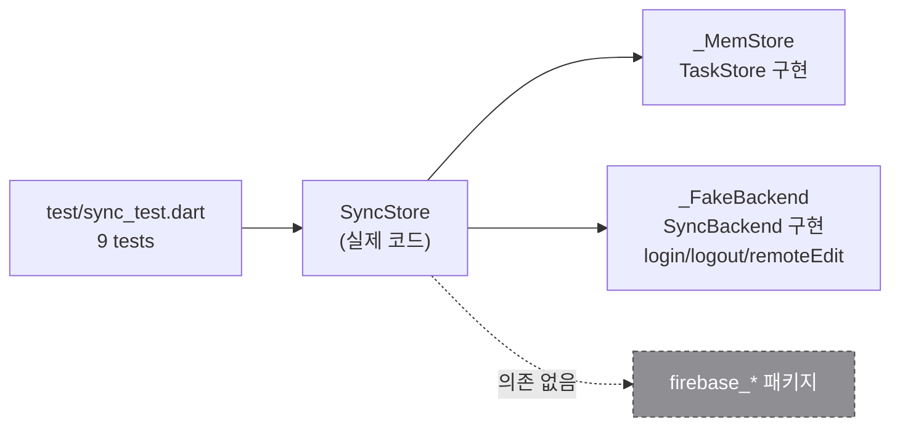

# Firebase 동기화 구조 보고서

> 작성: 2026-11-16 · 기준 커밋: `0d0c896` (브랜치 `희일`) · 분석 대상: 리베이스로 들어온 `0d6a331` "MP3: Firebase 동기화"
> 읽는 목적: **리베이스로 합쳐진 Firebase 코드가 어디에 어떻게 끼워졌는지** 파악

---

## 1. 요약 — 무엇이 들어왔나

`chohk1003`의 커밋 `0d6a331` 한 개로 MP3(백엔드 동기화) 전체가 들어왔다. 핵심은 **기존 코드를 거의 안 고치고 저장소 계층만 갈아끼운 것**이다.

| 구분 | 내용 |
|---|---|
| 선택한 BaaS | Firebase — Authentication(이메일/비밀번호) + Cloud Firestore |
| 추가된 패키지 | `firebase_core ^5.1.0`, `firebase_auth ^7.0.1`, `cloud_firestore ^7.1.0` |
| 새 파일 (lib) | `data/firebase_env.dart`, `data/auth_service.dart`, `data/firestore_backend.dart`, `pages/account_page.dart` |
| 기존 파일 (MP2 때 이미 준비) | `data/task_store.dart`(인터페이스), `data/sync_store.dart`(병합 로직) |
| 설정 파일 | `.env.example`, `firestore.rules`, `.gitignore`에 `.env`·`google-services.json` 제외 |
| 동기화 대상 | **태스크만** (`users/{uid}/tasks`). 완료 기록(`doneLog`)·설정은 기기별 로컬 보관 |
| Firebase 없이 실행 | `.env`가 없으면 로그인 UI까지 비활성 → 기존과 똑같은 **로컬 전용 게스트 모드** (크래시 없음) |

핵심 설계 두 줄로:

1. **로컬 우선(local-first)** — 화면은 항상 로컬(`shared_preferences`)에서 읽는다. 서버가 느리거나 끊겨도 앱이 안 멈춘다.
2. **항목 단위 Last-Write-Wins** — 충돌은 `updatedAt`이 더 늦은 쪽이 이기고, 삭제는 지우지 않고 `deleted: true` 표식(tombstone)을 남긴다.

---

## 2. 계층 구조 — 어디에 끼워졌나

`AppState`는 `TaskStore`라는 **인터페이스만** 본다. 그래서 그 자리에 `LocalStore`를 넣으면 로컬 전용, `SyncStore`를 넣으면 동기화 모드가 된다. **`AppState`·화면 코드는 저장소 종류를 모른다.**



주황 = 리베이스로 새로 들어온 것, 보라 = 갈아끼우기를 가능하게 하는 인터페이스.

### 파일별 역할

| 파일 | 줄 수 | 하는 일 |
|---|---:|---|
| `lib/data/firebase_env.dart` | 32 | `String.fromEnvironment`로 `.env` 값 4개를 읽어 `FirebaseOptions` 조립. 하나라도 비면 `configured == false` |
| `lib/data/auth_service.dart` | 81 | 이메일/비밀번호 로그인·가입·로그아웃. `ChangeNotifier`라 UI가 바로 따라감. 에러 코드를 한국어 문장으로 번역 |
| `lib/data/firestore_backend.dart` | 146 | `SyncBackend` 구현체. `users/{uid}/tasks` 읽기/쓰기/실시간 구독, Firestore 전용 필드 추가·제거 |
| `lib/data/sync_store.dart` | 243 | **Firebase 의존 없음.** 로컬 우선 쓰기, 대기 큐, `mergeTasks()` 순수 함수 LWW 병합 |
| `lib/data/task_store.dart` | 26 | `hasData`/`readTasks`/`readLog`/`readSettings`/`write` 5개짜리 저장소 계약 |
| `lib/pages/account_page.dart` | 269 | 로그인/회원가입 토글 폼, 로그인 후에는 이메일 + 로그아웃 버튼 |
| `firestore.rules` | 32 | 본인 문서만 접근 + **서버에서도 LWW 강제** + `delete` 금지 |

---

## 3. 앱 시작 흐름 (`main.dart`)

`.env` 유무가 모드를 가른다. 초기화가 실패해도 `catch`에서 `null`을 돌려주고 로컬 전용으로 계속 실행한다.



`flush()`를 미리 부르는 이유: 첫 실행 샘플 7개는 메모리에만 있어서, 저장하지 않으면 로그인했을 때 서버로 올라가지 않는다.

---

## 4. 쓰기 경로 — 로컬 먼저, 서버 나중

`AppState`의 모든 변경은 `notifyListeners()` → 250ms 디바운스 → `flush()` → `store.write()`로 흐른다. `SyncStore.write()`는 **로컬을 먼저 끝낸 뒤** 서버로 보낸다.



포인트 세 가지:

- **`set()`의 결과를 기다리지 않는다**(`unawaited`). 오프라인 큐는 Firestore SDK가 알아서 관리하므로 앱이 직접 네트워크 상태를 감시하지 않는다.
- **`_known` 맵**으로 "서버에 이미 올라간 버전"을 기억해 같은 값을 두 번 올리지 않는다. 업로드가 거절되면 `_known`에서 되돌려 다음에 다시 시도한다.
- **대기 큐(`_pending`)** 는 로그인 전(게스트)에 바뀐 id만 담는다. 로그인하면 `resync()`가 올리고 비운다.

---

## 5. 수신 경로와 충돌 해결 (LWW)

서버 변경은 두 길로 들어온다. ① 로그인 직후 `resync()`의 1회 `pullTasks()`, ② `snapshots()` 실시간 스트림. 둘 다 결국 `AppState.applyRemote()`에서 **항목 단위**로 병합된다.



`applyRemote`가 **객체를 바꿔치기하지 않고 필드만 수정**하는 게 중요하다. 편집 시트 같은 화면이 같은 `Task` 객체를 들고 있어서, 새 객체로 교체하면 화면과 데이터가 어긋난다.

### 로그인 직후 순서 (`SyncStore.resync`)



### 삭제는 tombstone



`AppState._live`가 `deleted` 항목을 전부 걸러서 화면·캘린더·집계에 안 보이게 한다. **목록 조회는 반드시 `_live`를 거쳐야 한다**(빠뜨리면 지운 항목이 남는다). 저장·동기화는 tombstone까지 포함한 `_tasks`를 쓴다.

---

## 6. Firestore 문서 구조와 보안 규칙

```
users/{uid}/tasks/{taskId}
```

문서 필드 = `Task.toJson()` 그대로 + 서버용 2개:

```json
{
  "id": "m3x9k2p0",
  "title": "운영체제 과제",
  "done": false,
  "due": "2026-11-03T00:00:00.000",
  "tags": ["assignment", "team"],
  "createdAt": "2026-11-02T21:40:12.000",
  "doneAt": null,
  "updatedAt": "2026-11-03T10:12:00.000",
  "deleted": false,

  "updatedAtMs": 1762146720000,
  "serverUpdatedAt": "<서버 타임스탬프>"
}
```

- `updatedAtMs` — 정수. **보안 규칙이 LWW를 비교할 때** 쓴다(문자열 ISO로는 규칙에서 비교가 안 된다).
- `serverUpdatedAt` — 콘솔에서 보기 좋게 남기는 서버 시각.
- 둘 다 읽을 때(`_fromDoc`) 제거한다. `Timestamp` 객체가 남으면 로컬 JSON 저장이 깨진다.

`firestore.rules`가 **클라이언트를 믿지 않고 서버에서도 같은 규칙을 강제**한다:



---

## 7. 로그인 UX



- 설정 화면 맨 위 `_AccountRow`가 `AuthService.instance`의 상태에 따라 문구를 바꾼다: `게스트 / 이 기기에만 저장 · 동기화 꺼짐` → `이메일 / 동기화 켜짐`.
- **익명 로그인을 쓰지 않은 이유**: 기기마다 다른 사용자가 되어 "두 기기에서 같은 목록"이 성립하지 않는다.
- 게스트로 쌓은 할 일은 로그인 시 `_pending` + `resync()`로 계정에 합쳐진다.

---

## 8. Firebase 없이도 테스트되는 구조

`sync_store.dart`가 **Firebase 패키지를 import하지 않는다**는 점이 테스트 설계의 핵심이다. `test/sync_test.dart`는 `_MemStore`(메모리 저장소) + `_FakeBackend`(메모리 서버)로 동기화 시나리오를 돌린다.



현재 테스트: `app_state_test.dart` 46건, `task_model_test.dart` 12건, `sync_test.dart` 9건, `local_store_test.dart` 7건, `widget_test.dart` 2건.

---

## 9. 리베이스 후 확인해야 할 것

분석 중에 나온, 지금 상태에서 **비어 있거나 어긋난 부분**이다.

| # | 항목 | 상태 |
|---|---|---|
| 1 | `pubspec.lock`, `windows/flutter/generated_plugin*` 미커밋 변경 | `flutter pub get`이 Firebase 3종을 반영한 결과. 커밋할지 결정 필요 |
| 2 | `docs/MP3_따라하기.md` **없음** | `README.md:15`·`README.md`(백엔드 설정 절차 절)·`docs/firebase.md` 상단이 이 파일을 가리키는데 어떤 커밋에도 존재하지 않는다 (링크 깨짐) |
| 3 | `docs/auth.md` 내용이 옛것 | "🔴 미착수 — 진입점만 있음"이라고 써 있지만 `AuthService`·`AccountPage`가 이미 구현돼 있다 |
| 4 | `docs/STATUS.md` 내용이 옛것 | 로그인 🔴, Firebase 🟡 "연결만 남음" — 실제로는 연결 코드까지 들어왔다 |
| 5 | `.env` 실제 값 | `.env.example`만 있다. 실행에는 Firebase 콘솔 값이 담긴 `.env`가 필요하고, 없으면 게스트 모드로만 돈다 |
| 6 | NFR-03 / NFR-04 측정값 | README 표가 "_측정 후 기록_" 상태. 두 기기 동기화 3초, 오프라인 복귀 5초 실측이 남아 있다 |
| 7 | `doneLog` · `settings` 동기화 | `SyncBackend.push()`는 `log`·`settings`를 인자로 받지만 `FirestoreBackend`는 **쓰지 않고 버린다**. 설계상 "기기별 보관"이라 의도된 것이지만, 인자로 남아 있어 오해 소지가 있다 |
| 8 | tombstone 정리 | 오래된 `deleted: true` 문서를 지우는 로직이 없다 (`docs/firebase.md`에도 미완 항목으로 적혀 있음) |
| 9 | `android/app/google-services.json` 없음 | `.gitignore`에 들어 있고, 설정은 `--dart-define`으로 넘기므로 현재 방식에선 필수는 아니다 |

---

## 10. 한눈에 보는 실행 방법

```bash
flutter run --dart-define-from-file=.env
```

```bash
flutter run
```

위가 동기화 모드(`.env` 필요), 아래가 로컬 전용 게스트 모드. 보안 규칙은 Firebase 콘솔 → Firestore Database → 규칙 탭에 `firestore.rules` 내용을 붙여 넣고 게시해야 적용된다.
