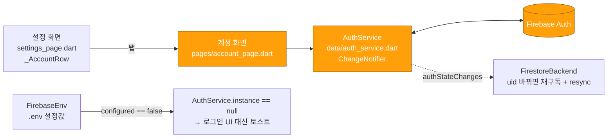
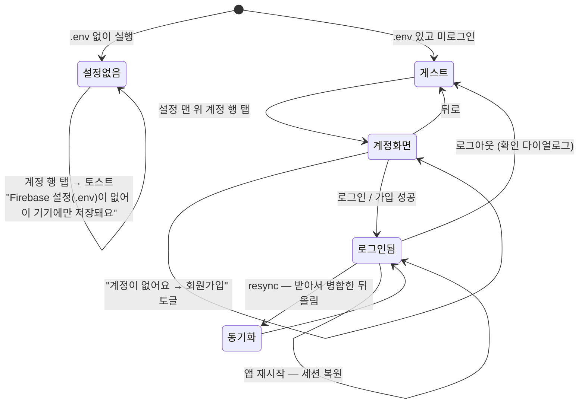
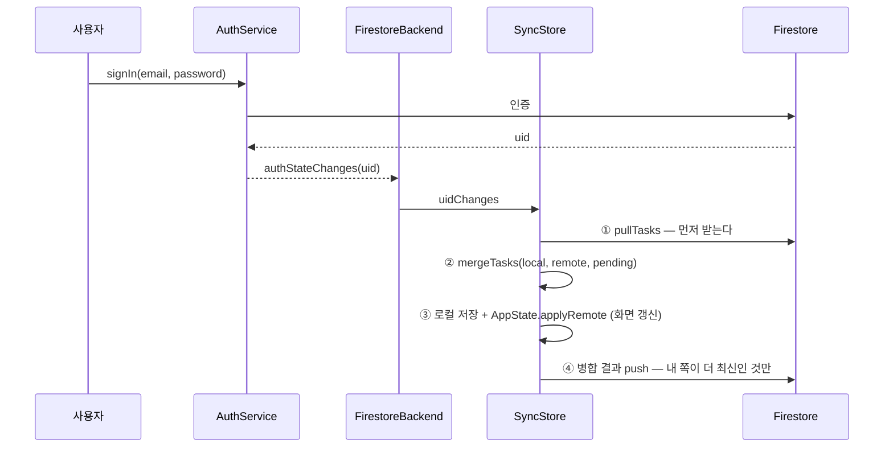

# 로그인 · 계정

> 🟢 **구현 완료** — 이메일/비밀번호 로그인·회원가입·로그아웃 · 요구사항 FR-01 · 단계 MP3
> 코드: `lib/data/auth_service.dart` · `lib/pages/account_page.dart` · 설정 화면의 `_AccountRow`
> 남은 일은 아래 "할 일" 2건(콘솔 설정·실기기 확인). 설정 절차는 [MP3_따라하기.md](MP3_따라하기.md).

## 할 일

- [ ] Firebase 콘솔 → Authentication → **이메일/비밀번호 로그인 켜기** (안 켜면 `operation-not-allowed`)
- [ ] 두 기기(또는 에뮬레이터 2대)에서 같은 계정으로 로그인 → 목록이 맞춰지는지 확인 (FR-11, [firebase.md](firebase.md))

## 구조

`AuthService`는 `ChangeNotifier`라서 로그인 상태가 바뀌면 설정 행과 계정 화면이 바로 따라 그려진다(`ListenableBuilder`).

### 화면 흐름

### 왜 익명 로그인을 쓰지 않았나

처음 계획은 "익명 + 이메일 연결"이었다. 익명 로그인은 **기기마다 다른 uid**가 되어 FR-11("두 기기에서 같은 목록")이 성립하지 않아서 이메일/비밀번호만 쓴다.

게스트로 쌓은 할 일은 익명 계정 없이도 승계된다 — 로그인 전 변경은 `SyncStore`의 대기 큐(`_pending`)에 id로 남고, 로그인 시 `resync()`가 서버와 병합해 올린다 ([firebase.md](firebase.md#동기화-규칙)).

### 게스트 데이터 승계

순서가 중요하다. 먼저 올리면 이 기기의 오래된 값이 다른 기기의 최신 수정을 덮어쓴다.

## 구현 위치

| 파일 | 역할 |
|---|---|
| `lib/data/auth_service.dart` | `signIn` · `signUp` · `signOut` · `signedIn` · `email`. 성공 시 `null`, 실패 시 **한국어 문장**을 돌려준다(`messageOf`) |
| `lib/data/auth_service.dart` | `AuthService.init()` — `Firebase.initializeApp()` 뒤 한 번. 미설정이면 `instance`가 `null`로 남는다 |
| `lib/pages/account_page.dart` | 로그인/회원가입 토글 폼, 전송 중 스피너, 오류 문구, 로그인 후 이메일 + 로그아웃 버튼 |
| `lib/pages/settings_page.dart` | `_AccountRow` — `게스트 / 이 기기에만 저장 · 동기화 꺼짐` ↔ `이메일 / 동기화 켜짐` |
| `lib/main.dart` | `_startFirebase()` — `.env`가 없거나 초기화가 실패하면 로그인 없이 로컬 전용으로 계속 실행 |

### 오류 문구

`FirebaseAuthException.code`를 그대로 보여주지 않고 번역한다.

| code | 보여 주는 문장 |
|---|---|
| `invalid-email` | 이메일 형식이 올바르지 않아요. |
| `user-not-found` · `wrong-password` · `invalid-credential` | 이메일 또는 비밀번호가 맞지 않아요. |
| `email-already-in-use` | 이미 가입된 이메일이에요. 로그인해 주세요. |
| `weak-password` | 비밀번호는 6자 이상이어야 해요. |
| `network-request-failed` | 인터넷에 연결되어 있지 않아요. |
| `operation-not-allowed` | Firebase 콘솔에서 이메일/비밀번호 로그인을 켜 주세요. |
| `too-many-requests` | 시도가 너무 많아요. 잠시 뒤 다시 해 주세요. |

> 테스트에는 실제 이메일 대신 `test1@keepy.dev` 같은 가짜 주소를 쓴다. Firebase는 메일 존재 여부를 확인하지 않는다.

## 정책

| 상황 | 동작 |
|---|---|
| `.env` 없음 | 로그인 UI 자체가 비활성. 이 기기에만 저장(게스트) |
| 게스트 | 로컬 저장 정상. 변경 id는 대기 큐에 적립 |
| 로그인 | 서버와 병합 후 동기화 시작 |
| 로그아웃 | **이 기기 목록은 그대로 남고** 동기화만 멈춤 (화면에도 그렇게 안내) |
| 앱 재시작 | `firebase_auth`가 세션을 복원 → 다시 로그인하지 않아도 동기화 계속 |

로컬 저장 키에는 uid를 붙이지 않았다. 한 기기를 여러 계정이 번갈아 쓰는 경우는 과제 범위 밖이고, 붙이면 게스트 → 로그인 승계가 복잡해진다.

## 보안 (NFR-06, CST-04)

- [x] API 키는 `.env`로 분리, 저장소에는 `.env.example`만 둔다 (`lib/data/firebase_env.dart`)
- [x] `.gitignore`에 `.env` · `*.env` · `google-services.json` · `firebase_options.dart` 추가
- [x] `firebase_options.dart`를 만들지 않고 `--dart-define-from-file=.env`로 넘기는 방식을 택했다
- [x] 비밀번호는 로컬에 저장하지 않는다 — 세션은 `firebase_auth`가 관리

## 완료된 것

- [x] 설정 화면에 '게스트' 진입점 자리 확보 (2026-11-03)
- [x] 로그인 방식 결정 — 이메일/비밀번호 (익명 제외, 사유 위 참고) (2026-11-15)
- [x] `firebase_auth` 추가 + `AuthService` 구현 (2026-11-15)
- [x] 계정 화면 신규 — `lib/pages/account_page.dart` (계획의 `login_page.dart`에서 이름 변경) (2026-11-15)
- [x] 설정 계정 행이 로그인 상태에 따라 문구 변경 (2026-11-15)
- [x] 로그아웃 정책 결정 — 로컬 데이터 유지, 동기화만 중단 (2026-11-15)
- [x] 사용자별 로컬 키 분리는 **하지 않기로** 결정 (2026-11-15)
