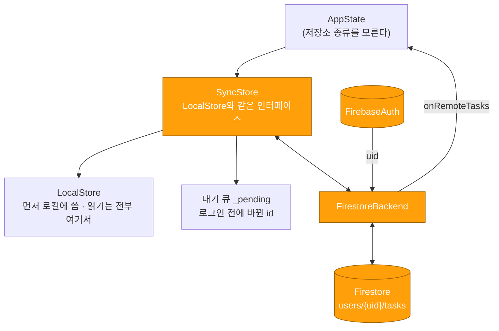
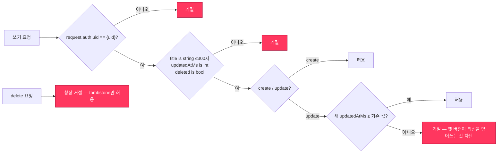
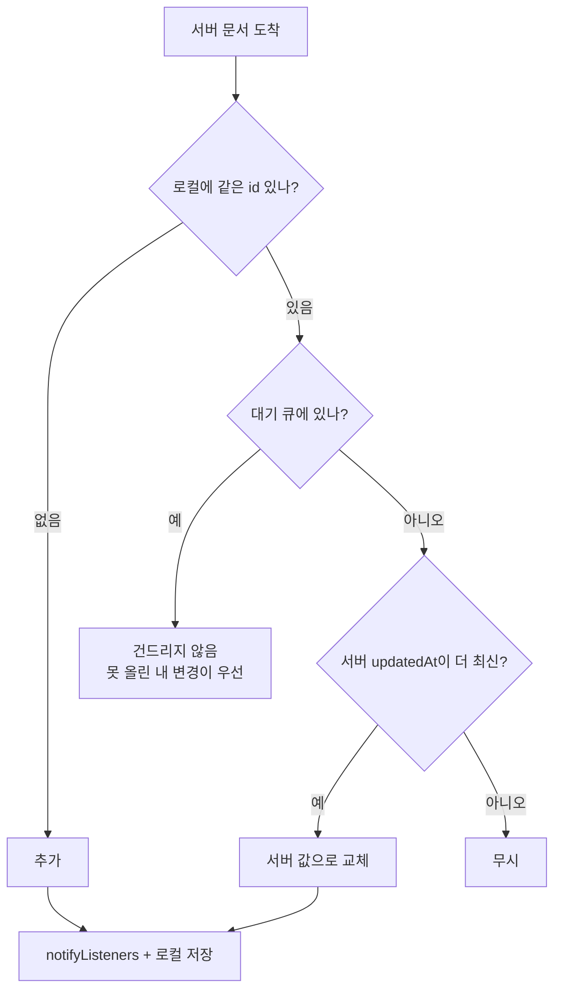
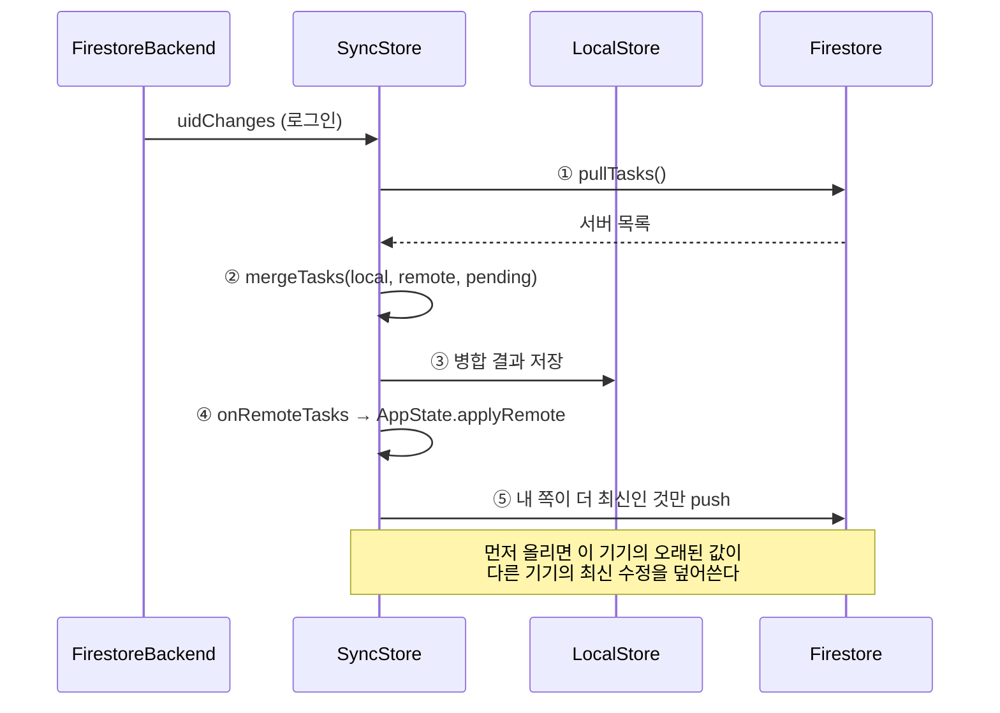
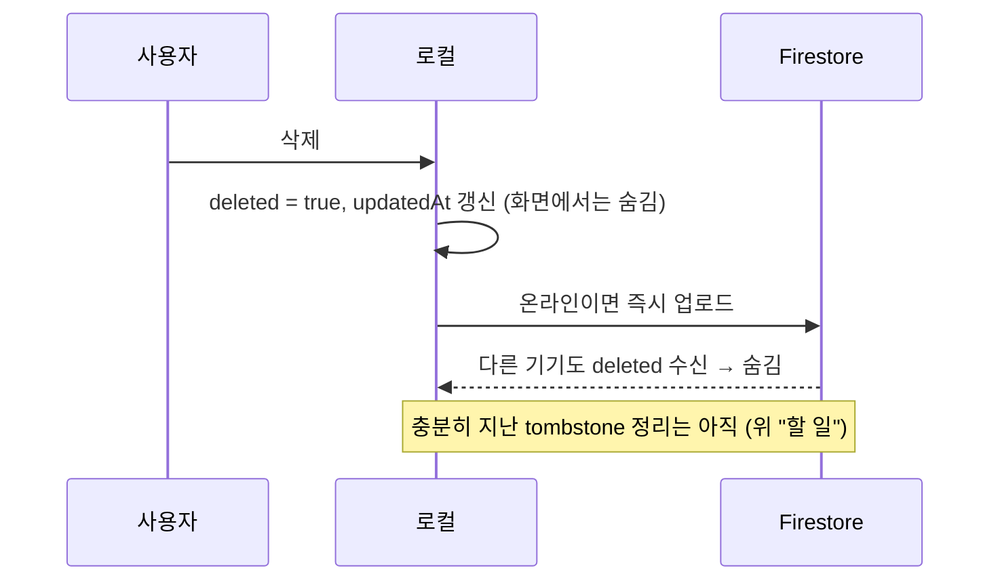
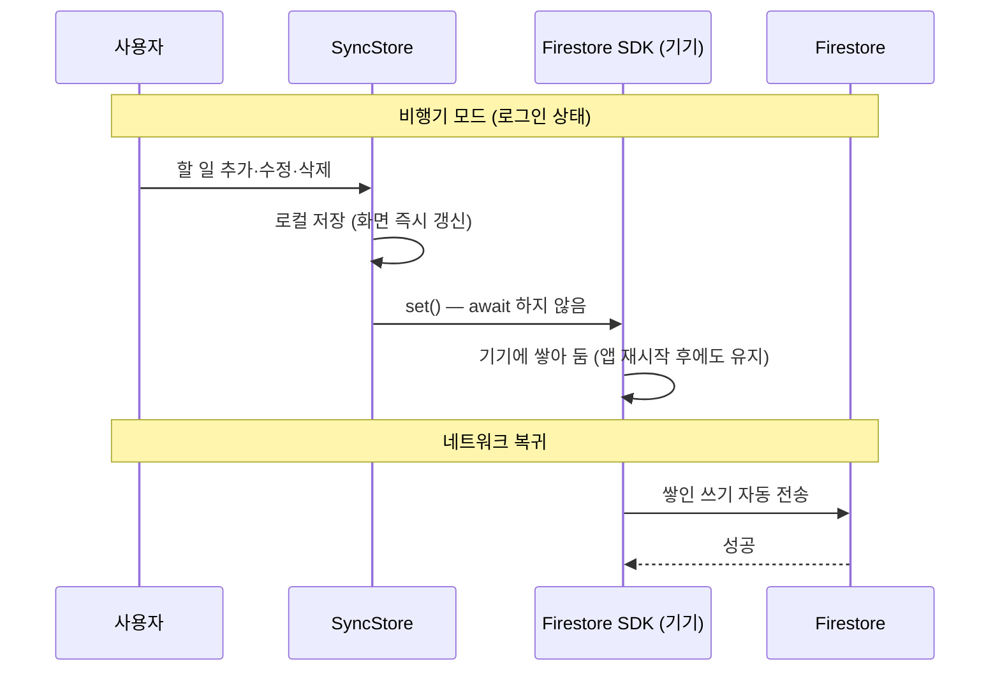

# Firebase 동기화

> 🟢 **연결 코드 완료, 콘솔 설정·실측 남음** — 요구사항 FR-11, FR-12, NFR-03, NFR-04 · 단계 MP3
> 코드: `lib/data/sync_store.dart` · `firestore_backend.dart` · `firebase_env.dart` · `AppState.applyRemote` · `firestore.rules`
> 설정·확인 절차는 [MP3_따라하기.md](MP3_따라하기.md), 충돌 처리 방침 요약은 루트 [README](../README.md) "MP3" 절.
> 전체 구조를 한 번에 보려면 [FIREBASE_구조_보고서.md](FIREBASE_구조_보고서.md).

## 할 일

### 콘솔 설정 (사용자)

- [ ] Firebase 콘솔에서 프로젝트 생성 + Android 앱 등록 → `.env` 값 4개 채우기
- [ ] Authentication → 이메일/비밀번호 로그인 켜기
- [ ] Firestore Database 만들기 + [`firestore.rules`](../firestore.rules) 붙여넣고 게시

### 검증 (FR-11 · FR-12 · NFR-03 · NFR-04)

- [ ] 두 기기(또는 에뮬레이터 2대)에서 같은 계정 로그인 → 양쪽 반영 확인 (FR-11)
- [ ] 비행기 모드에서 작성 → 복귀 후 전송 확인 (FR-12)
- [ ] **실측값 README 기록** — 동기화 3초 이내(NFR-03), 오프라인 복귀 5초 이내(NFR-04)

### 남은 구현

- [ ] 오래된 tombstone 정리 — `deleted: true` 문서가 계정에 계속 쌓인다
- [ ] `doneLog` · 설정 동기화 여부 결정 — 지금은 기기별 로컬 보관이고, `SyncBackend.push()`가 받는 `log`·`settings` 인자는 `FirestoreBackend`에서 쓰지 않는다

## 구조



**로컬 우선(local-first)** — 항상 로컬에 먼저 쓰고 화면을 갱신한 뒤, 네트워크는 뒤에서 처리한다. 그래야 오프라인에서도 느려지지 않는다.

`AppState`는 `TaskStore`(`lib/data/task_store.dart`)만 보기 때문에 **`AppState`를 고치지 않고** `LocalStore` 자리에 `SyncStore`가 들어갔다. 실제로 `main.dart`에서 바뀐 건 저장소를 고르는 부분뿐이다.

```dart
// main.dart — .env가 있으면 동기화, 없으면 로컬 전용
final local = await LocalStore.open();
final sync = await _startFirebase(local);   // 실패하면 null
final state = AppState(store: sync ?? local);
```

| 심볼 | 상태 | 하는 일 |
|---|---|---|
| `TaskStore` | 🟢 | `AppState`가 보는 저장소 계약 |
| `SyncStore` | 🟢 | 로컬 우선 쓰기 · 대기 큐 · `mergeTasks()` LWW 병합 · 실시간 구독 시작 |
| `SyncBackend` | 🟢 인터페이스 | 원격 추상화 (`uid` `canSync` `push` `pullTasks` `watchTasks` `uidChanges`) |
| `NoopSyncBackend` | 🟢 | 기본값. 끼워도 로컬 전용과 동작이 같다 |
| `FirestoreBackend` | 🟢 | Firestore 구현 — 문서 변환, 실시간 구독, 중복 업로드 차단 |
| `AppState.applyRemote` | 🟢 | 수신 목록을 항목별 LWW로 병합 (객체 교체 없이 필드만 수정) |

`sync_store.dart`는 **Firebase 패키지를 import하지 않는다.** 그래서 `test/sync_test.dart`가 메모리 가짜 백엔드로 동기화 시나리오를 검증할 수 있다.

## Firestore 문서 구조

```
users/{uid}/tasks/{taskId}
```

`doneLog`와 설정은 올리지 않는다(기기별 보관). 태스크 문서는 **로컬 JSON 형식을 그대로** 쓰고 서버용 필드 2개만 더한다.

```json
{
  "id": "m3x9k2p0",
  "title": "운영체제 과제",
  "done": false,
  "due": "2026-11-03T00:00:00.000",
  "tags": ["assignment", "team"],
  "createdAt": "2026-11-02T21:40:12.000",
  "doneAt": null,
  "updatedAt": "2026-11-03T10:12:00.000",
  "deleted": false,

  "updatedAtMs": 1762146720000,
  "serverUpdatedAt": "<서버 타임스탬프>"
}
```

- `updatedAtMs` — 정수. **보안 규칙에서 LWW를 비교**할 때 쓴다 (문자열 ISO는 규칙에서 비교가 안 된다).
- `serverUpdatedAt` — 콘솔에서 보기 좋게 남기는 서버 시각.
- 둘 다 읽을 때(`_fromDoc`) 제거한다. `Timestamp` 객체가 남으면 로컬 JSON 저장이 깨진다.

`updatedAt`·`deleted`가 동기화를 위해 새로 필요했던 두 필드다. 로컬 저장 키도 `keepy.*.v2`로 올렸다 ([storage.md](storage.md#키-버전-마이그레이션-v1--v2)).

### 보안 규칙 ([firestore.rules](../firestore.rules))

클라이언트를 믿지 않고 서버에서도 같은 규칙을 강제한다.



## 동기화 규칙

### 충돌 해결: Last-Write-Wins



두 곳에 구현돼 있다.

| 구현 | 쓰는 곳 | 특징 |
|---|---|---|
| `SyncStore.mergeTasks({local, remote, pending})` | `resync()`, 화면이 안 붙은 경우 | **순수 함수** — Firebase 없이 단위 테스트 |
| `AppState.applyRemote(remote)` | 실시간 수신 (`main.dart`에서 연결) | 기존 `Task` **객체의 필드만** 수정 — 편집 시트가 같은 객체를 들고 있어서 바꿔치기하면 화면이 어긋난다 |

`updatedAt`이 없거나 깨진 문서는 `createdAt`으로, 그것도 없으면 아주 과거로 보고 비교한다 (구버전 문서가 섞여도 안전).

**첫 실행 샘플 7개**는 기기마다 같은 id(`sample-1`…)에 `updatedAt = 2000년`으로 만든다. 두 기기에서 로그인해도 두 벌로 늘지 않고, 다른 기기에서 고치거나 지운 샘플이 되살아나지 않는다 (LWW에서 항상 짐).

### 로그인 직후 — 받고 나서 올린다



### 삭제 — tombstone

문서를 지우지 않고 `deleted: true` 표식만 남긴다. 그래야 오프라인 기기에도 삭제가 전달되고, 지운 항목이 옛 데이터 때문에 되살아나지 않는다.



`AppState.remove()`가 `deleted = true`만 세우고, 조회 쪽 `AppState._live`가 걸러 낸다. 되돌리기(`restore(index, task)`)는 표식을 되돌리고 **보이는 목록 기준 위치**로 되돌려 넣는다 — tombstone 때문에 `_tasks`의 실제 인덱스와 화면 인덱스가 다르므로 `_rawIndexOfLive()`로 변환한다.

> **목록 조회는 반드시 `_live`를 거쳐야 한다.** 빠뜨리면 지운 항목이 캘린더나 집계에 남는다. 저장·동기화는 tombstone까지 포함한 `_tasks`를 쓴다 ([tasks.md](tasks.md#할-일)).

### 오프라인 → 복귀 (FR-12, NFR-04)



**오프라인 큐는 Firestore SDK가 맡는다.** 그래서 앱이 직접 네트워크 상태를 감시하지 않는다. `SyncStore._pending`은 "로그인 전(게스트)에 바뀐 id"만 담는 별개의 큐다.

업로드 중복은 `FirestoreBackend._known`(id → `updatedAt`)으로 막는다. 보안 규칙이 옛 버전 업로드를 거절하면 `_known`에서 되돌려 다음 쓰기·로그인 때 다시 시도한다.

## 측정 방법 (제출용)

| 항목 | 기준 | 재는 법 |
|---|---|---|
| NFR-03 동기화 반영 | 3초 이내 | 기기 A에서 추가 → 기기 B 화면에 뜰 때까지 |
| NFR-04 오프라인 복귀 | 5초 이내 | 비행기 모드 해제 → 서버 반영까지 |

측정값은 README에 적는다. 절차는 [MP3_따라하기.md](MP3_따라하기.md) 5·6장.

## 왜 Firebase인가 (Supabase와 비교)

| 비교 | Firebase | Supabase |
|---|---|---|
| 오프라인 | **SDK가 쓰기를 기기에 쌓아 두었다가 자동 전송** (앱 재시작 후에도 유지) | 직접 큐를 구현해야 함 |
| 실시간 | `snapshots()` 한 줄 | Realtime 채널 설정 필요 |
| 데이터 모델 | 문서형 — 지금 JSON을 그대로 저장 | 관계형 — 테이블 설계·변환 필요 |
| 무료 요금제 | Spark (카드 등록 없음) | Free |

MP3의 핵심인 **오프라인 작성 → 온라인 복귀 반영**을 SDK가 기본으로 해 주고, 이미 쓰는 `Task.toJson()`을 변환 없이 문서로 올릴 수 있어서 Firebase를 골랐다.

## 알려진 한계

- `updatedAt`은 **각 기기의 시계**를 쓴다. 기기 시계가 크게 틀리면 LWW 판정이 어긋날 수 있다.
- `doneLog`·설정은 동기화하지 않는다 (기기별).
- tombstone이 계정에 계속 쌓인다 (정리 미구현).

## 완료된 것

- [x] `Task`에 `updatedAt` · `deleted` 추가, 구버전 JSON 하위호환 (2026-11-09)
- [x] 저장 키 `v2` + v1 → v2 마이그레이션 (2026-11-09)
- [x] `TaskStore` 인터페이스 분리 — `AppState`가 저장소 종류를 모르게 (2026-11-09)
- [x] `SyncBackend` 인터페이스 + `NoopSyncBackend` + `SyncStore` (로컬 우선 쓰기 · 대기 큐 · LWW 병합) (2026-11-09)
- [x] BaaS 선정 — Firebase (2026-11-15)
- [x] 의존성 추가 — `firebase_core ^5.1.0` · `firebase_auth ^7.0.1` · `cloud_firestore ^7.1.0` (2026-11-15)
- [x] Android `minSdk` 23으로 상향 (`android/app/build.gradle.kts`) (2026-11-15)
- [x] `.env` / `.env.example` 분리 + `.gitignore` 등록 (NFR-06, CST-04) (2026-11-15)
- [x] `main()`에 Firebase 초기화 — 실패해도 로컬 전용으로 계속 실행 (2026-11-15)
- [x] `FirestoreBackend` — `push` · `pullTasks` · `watchTasks` · 실시간 구독 (2026-11-15)
- [x] Firestore 스키마 확정 (`users/{uid}/tasks/{taskId}`) (2026-11-15)
- [x] 실시간 수신 → `SyncStore.onRemoteTasks` → `AppState.applyRemote` 연결 (2026-11-15)
- [x] `canSync` 판정 — 네트워크 감시 대신 "로그인했는가"로 단순화, 오프라인 큐는 SDK에 맡김 (2026-11-15)
- [x] `remove()`를 tombstone으로 전환 + 되돌리기 인덱스 변환 (2026-11-15)
- [x] 보안 규칙 작성 — 본인 문서만 + 서버 측 LWW 강제 + `delete` 금지 (2026-11-15)
- [x] 첫 실행 샘플을 고정 id + 과거 `updatedAt`으로 — 기기 간 중복 방지 (2026-11-15)
